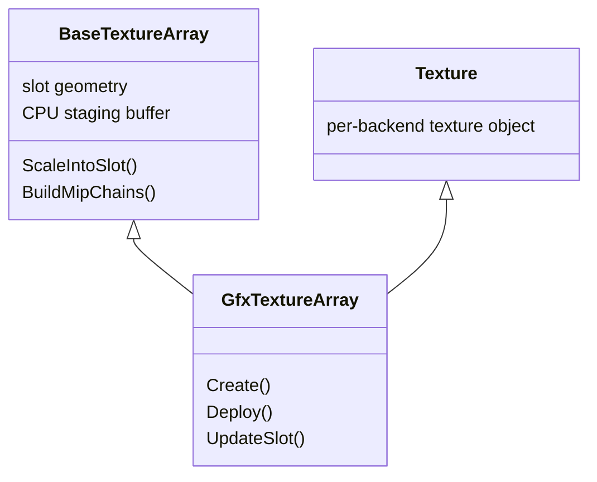
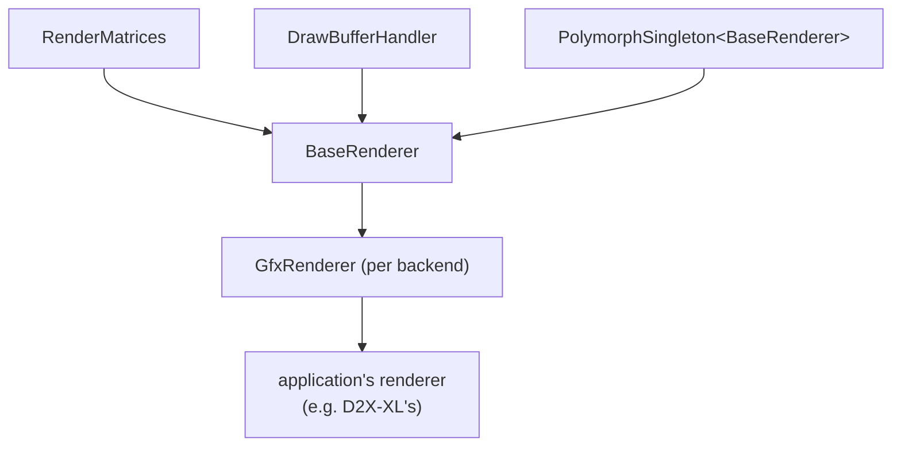

# Layering and Specialization

The library has to be three libraries at once: an OpenGL one, a Vulkan one and a DirectX 12 one, with
the same behaviour and the same call sites. It does that without an abstract interface layer, and
without a single virtual call between the application and the driver.

Three mechanisms carry the whole structure. They are orthogonal and used for different reasons.

## 1. One name, three files - the build picks

The load-bearing decision. A class that has to exist in every backend exists *once per backend*, in a
file of the same name, under that backend's `include/` and `src/`:

```
opengl/include/texture.h      class Texture   (GL texture name, glTexImage2D)
vulkan/include/texture.h      class Texture   (VkImage + VkImageView + VMA allocation, layout tracker)
directx/include/texture.h     class Texture   (ID3D12Resource + SRV descriptor index)
```

Shared code writes `#include "texture.h"` and `Texture`, and the include path decides which one it
gets. Everything that is rendered - a mesh, a font, the skybox - is compiled against one backend's
types directly.

The classes that work this way are the ones that touch the driver:

| Name | Role |
| --- | --- |
| `GfxRenderer` | the concrete renderer, derived from the shared `BaseRenderer` |
| `GfxStates` | render state (see [02](02-api-abstraction.md)) |
| `Shader`, `ComputeShader` | program objects and their parameters |
| `Texture`, `GfxTextureArray`, `Cubemap`, `TextureBuffer`, `LinearTexture` | texture shapes |
| `RenderTarget`, `GfxReadTarget` | offscreen targets and readback |
| `GfxDataBuffer`, `GfxDataLayout`, `GfxArray` | vertex buffers and layout; GPU arrays (storage, instance and indirect buffers) |
| `MeshHandler` | mesh instantiation |
| `BaseDisplayHandler`, `SDLHandler` | window, swap chain, present |
| `CommandList` | recorded GPU work (Vulkan and DX only) |
| `AccelerationStructure` | ray tracing (Vulkan and DirectX; a stub in OpenGL) |
| `BindlessTextureHeap` | the bindless texture table (Vulkan and DX only) |
| `GfxXRHandler` | the graphics half of the OpenXR session (Vulkan and DirectX; a stub in OpenGL) |

Where a backend cannot provide something, it still provides the name, as a stub with the same
signatures, so that the shared code and the applications compile: `AccelerationStructure` and
`GfxXRHandler` in OpenGL, whose calls fail or report "no session", and
`GfxRenderer::ShutdownGraphics` / `RestartGraphics`, which do nothing there.

A variant of the same mechanism: some classes have one shared header and one implementation per
backend - `TextureHandler`, and `BaseShaderCode`, whose per-backend source file also holds the list of
shader sources that backend registers.

### Why not an interface with virtual methods

An interface would mean a vtable dispatch on every texture bind, buffer update and state change, a
second object per resource, and a lowest common denominator API frozen at the moment the interface
was written. None of it buys anything, because **no binary ever contains two backends**. The choice
is made when the library is built, so a runtime dispatch would decide something that is already
decided.

What this costs: the three files drift unless they are kept aligned deliberately. There is no
compiler check that `Texture` in the Vulkan build has the same interface as in the OpenGL build - the
only check is that the shared code compiles against all three. In practice that catches signature
drift quickly, because everything above the backend is shared. The check is only as wide as the
shared code each build compiles, though: the OpenGL build does not compile the OpenXR core,
`OceanFFT`, `PoseSpline` or the HLSL sources, and some calls exist only in the Vulkan and DirectX
classes (indirect draws and instance streams, bindless textures, `GetDeviceInfo`, `GetMemoryBudget`).

What it buys, besides the call cost: each backend can be written idiomatically. The Vulkan `Texture`
carries an image layout tracker and its memory allocation, the DX one a descriptor index, the GL one
nothing but a name. Nothing has to be modelled twice or emulated.

## 2. Base class in `include/`, specialization in the backend

Where a class has substantial work that contains no API at all, that work is lifted into a base class
in the shared `include/`, and each backend derives from it and adds only the API part.



`BaseTextureArray` holds the slot geometry, one flat CPU buffer in exactly the layout every backend's
3D upload call wants, the bilinear scaler that fits an undersized image into a slot, and the mip chain
builder. `GfxTextureArray` adds the upload - and nothing else. Three backends therefore share one
implementation of the only part that is real work.

The shared halves currently in `include/`:

| Base class | Specialization adds |
| --- | --- |
| `BaseRenderer` | `GfxRenderer`: device init and restart, command lists, present, back buffer read |
| `BaseTextureArray` | the upload of the staged slots |
| `BaseNoiseTexture` | the upload of generated noise volumes |
| `BaseReadTarget` | the backend's readback path (`GfxReadTarget`) |
| `BaseXRHandler` | `GfxXRHandler` (Vulkan, DirectX): instance and device creation through the OpenXR runtime, the graphics binding, the swapchain formats and the render targets on the swapchain images |

Three names in this family do not fit the pattern. `BaseShaderHandler` has no backend half: the
application derives its own shader handler from it, and what differs per backend is the shader table
it owns, `BaseShaderCode` (shared header, one implementation per backend). `BaseQuadMesh` is not
specialized either; it combines the shared `Quad` and `Mesh` and reaches the backend through the
mesh's `GfxDataLayout`. And `BaseDisplayHandler` is not a shared half at all but a per-backend class
(section 1) from which the application derives its display handler.

Note what most of these base classes are *not*: they are not polymorphic interfaces.
`BaseTextureArray` has a non-virtual destructor on purpose - nothing holds one through a base
pointer. The inheritance is code sharing, not dispatch. The exceptions are deliberate and few:

- `BaseRenderer`, `BaseShaderHandler` and `BaseDisplayHandler` are derived from by the application,
  for the reason given below.
- `BaseXRHandler` is the one shared class that calls down into its backend half: the OpenXR session
  logic is API-free, creating the device through the runtime, the graphics binding and the swapchain
  images are not, and those few steps are virtual hooks that `GfxXRHandler` implements. They run when
  a session is set up, not per draw.
- `GpuResource` (`include/gpuregistry.h`) is a real interface. `Texture`, `RenderTarget`, `GfxArray`,
  `GfxReadTarget`, `AccelerationStructure` and the shared `Mesh` implement "release the GPU side" and
  "rebuild it from the kept CPU data and creation parameters"; `GpuRegistry` holds every live one.
  That is what lets `GfxRenderer::RestartGraphics` take the device down and bring it back - for
  instance when VR is switched on and the OpenXR runtime has to create the device - without the
  application recreating its resources. Vulkan and DirectX only; in OpenGL the restart does nothing.

## 3. The renderer is meant to be derived from - twice

`BaseRenderer` is the one place where virtual dispatch is deliberate, because there are two
independent layers of specialization stacked on it:



- **`GfxRenderer`** specializes it per API. It overrides `InitGraphics` (which takes the device
  feature request, see [02](02-api-abstraction.md)), `StartOperation` / `FinishOperation`,
  `DrawScreen`, the pipeline cache hooks (load, save, precreate) and the resource hooks
  (`FlushResources`, `Cleanup`, and in Vulkan `ReserveMemory`). `ReadBuffer` and `ShutdownGraphics` /
  `RestartGraphics` are not virtual - every backend's `GfxRenderer` simply has them.
  `#define baseRenderer GfxRenderer::Instance()` is how everything reaches it.
- **The application** specializes it again, for what a viewport, a scene buffer or a camera means in
  that game. `SetViewport`, `SetSceneBuffer`, `ActivateCamera`, `UsePostEffectShader` are virtual for
  that reason: D2X-XL's renderer, for instance, adds the scissoring that the viewport transformation
  cannot do. The same two-layer use applies to the display handler, whose `OnMinimized` /
  `OnRestored` let an application stop its clock while the window is minimized, and to the shader
  handler.

`PolymorphSingleton` is what makes the second layer work: the instance pointer is typed on
`BaseRenderer`, the derived constructor assigns it, and each level's `Instance()` narrows it with a
`dynamic_cast`. So the library's own code reaches the renderer through `BaseRenderer`, while the
application reaches its own through the same singleton.

`BaseRenderer` also *inherits* two of its responsibilities rather than owning them as members:
`RenderMatrices` (the matrix stacks and the projector) and `DrawBufferHandler` (the render target
stack). Both are shared, and every call site wants them on the renderer - `baseRenderer.PushMatrix()`,
`baseRenderer.ResetDrawBuffers()`.

## Access through singleton macros

The library's services are singletons, reached through a lower-case macro that reads like a global
object:

```
baseRenderer  gfxStates  baseShaderHandler  textureHandler  meshHandler
baseDisplayHandler  sdlHandler  commandListHandler  gfxResourceHandler
cbvAllocator  descriptorHeaps  descriptorPoolHandler  samplerCache
pipelineCache  vkContext  dx12Context  bindlessTextureHeap  xrHandler
xrView  skybox  shadowMap  textRenderer  lightningLook
```

Two more come from basetools and are used throughout the library: `logHandler` and `missingFiles`.

Several exist only in some backends - `descriptorHeaps` and `dx12Context` are DirectX,
`descriptorPoolHandler`, `pipelineCache` and `vkContext` are Vulkan, `commandListHandler`,
`cbvAllocator`, `samplerCache`, `gfxResourceHandler` and `bindlessTextureHeap` exist in both but not
in OpenGL. `xrHandler` exists in all three, as a stub in OpenGL. Shared code does not name the
backend-only ones; they appear only inside the backend that has them, or behind a `BaseRenderer`
virtual (`FlushResources`, `Cleanup`, `LoadPipelineCache`, `SavePipelineCache`,
`PrecreatePipelines`, `ReserveMemory`) that is a no-op in OpenGL. The one exception is the OpenXR core
in `src/base_xrhandler.cpp`, which is shared but compiled only by the Vulkan and DirectX builds.

Not every service is a singleton object: `GpuRegistry` is a class of static functions, `ShaderCache`
and Vulkan's `Vk13Api` are namespaces.

`gfxStates` and `baseRenderer` are the two the application sees constantly.

## Where the boundary actually runs

A useful way to read the layout: shared code may name anything in `include/`, plus the *names* listed
in section 1. It may not name a driver type - no `GLuint`, no `VkImage`, no `ID3D12Resource`. Where a
shared class needs to store a handle, it stores `GfxTypes::Handle`; where it needs a format, it stores
`GfxPixelFormat`. Both are described in [02-api-abstraction.md](02-api-abstraction.md).

A handful of shared files still test the backend symbol: `rendermatrices.h` also loads the
fixed-function matrices under OpenGL, and `drawbufferhandler.cpp` tells the display handler to suspend
or reopen the back buffer's rendering scope under Vulkan and DirectX.

The one systematic exception is the shader code: the Vulkan and DirectX shaders are written once in
HLSL (`src/common-hlsl`) and compiled by DXC for both, while the OpenGL backend has its own GLSL
sources. That is [08-shaders.md](08-shaders.md).

## Divergences

- **`gfxtypes.h` and `gfxdrivertypes.h` are near-duplicates.** Both define `namespace GfxTypes` with
  the same aliases; `gfxdrivertypes.h` lacks `Bitfield` (in the Vulkan and DirectX copies) and all tag
  structs. Only `opengl/include/gfxstates.h` includes `gfxdrivertypes.h`; nothing else in the library
  does, so the Vulkan and DirectX copies are unused. The OpenGL `gfxtypes.h` lacks the
  `InstanceBuffer` and `IndirectBuffer` tags of the other two.
- **Copied header comments.** `vulkan/include/gfxtypes.h` carries the DirectX file's comment text
  ("DirectX 12-specific type aliases", "directx/include/ takes precedence"), `vulkan/include/
  gfxstates.h` speaks of D3D12 translation, SRV heap indices and DX12 viewport state, and the shared
  `base_renderer.h` / `base_renderer.cpp` and the OpenGL `gfxrenderer.h` carry "DX12" headings.
  Several of them refer to a `SetupOpenGL` / `SetupDX12` that no longer exists - the function is
  `SetupGraphics`. The code is correct; the comments name the wrong backend.
- **Include order does not actually give the backend precedence**, although several comments say it
  does: the project files list `..\..\include` (shared) *before* `..\include` (backend). It works
  because no file name exists in both directories - there is no `gfxtypes.h`, `texture.h` or
  `shader.h` in the shared `include/`. The mechanism is "the file exists in exactly one place", not
  "the backend wins". The Linux Makefiles list the backend's `include/` first, so there the backend
  would win - which, with no duplicate names, makes no difference either.
- **`src/gfxapitype.inl` is dead.** It assigns `BaseRenderer::gfxApiType` from the `DIRECTX` /
  `VULKAN` preprocessor symbols - the mechanism that preceded today's assignment in each
  `GfxRenderer` constructor. Its only `#include` is at the end of `opengl/src/ogl_base_renderer.cpp`,
  and that file is not in the OpenGL project; all three project files list the `.inl` as a
  non-compiled item.
- **`opengl/src/ogl_base_renderer.cpp`, `opengl/include/ogl_base_renderer.h` and
  `opengl/src/ogl_shadowmap.cpp` are not built** - no project file compiles them and no header
  includes them. The OpenGL build takes `BaseRenderer` from the shared `src/base_renderer.cpp`, as
  the other two backends do.
- **More files that no build uses.** `SSBO.cpp` in all three backends' `src/` is empty and in no
  project or Makefile. The shared `src/noisetexture3d.cpp` (which calls OpenGL directly) and
  `src/vertexdatabuffers.cpp` are in no project or Makefile. `vulkan/include/dx12context.h`,
  `dx12framework.h`, `dx12upload.h` and `vulkan/src/dx12context.cpp` are DirectX files in the Vulkan
  tree, compiled by nothing. `gputimer.h` and `gpuzone.h` are included by no library source, only by
  the applications (D2X-XL uses `gpuzone.h`); the Vulkan and DirectX copies of `gputimer.h` hold the
  OpenGL query code behind `#ifdef OPENGL`. `directx/cpp/perlin.cpp` and `opengl/cpp/perlin.cpp` are in no project or
  Makefile, and `dx12framework.h` / `framework.h` in the `visualstudio` folders are included by
  nothing.
- **`psoHandler` names a class that does not exist.** `directx/include/renderstates.h` defines
  `psoHandler` as `PSOHandler::Instance()`, but there is no `PSOHandler`; the DirectX pipeline cache
  is the static class `PSO`, and nothing uses the macro.
- **The OpenGL build still uses SDL 2** (project and Makefile include paths) while the shared sources
  it compiles include SDL 3 headers (see [00](00-overview.md)).
- **`directx_tmp_placeholder`** is an empty, untracked file in the `rendertools` folder.
