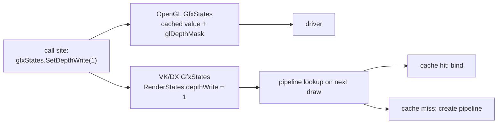

# The API-Neutral Vocabulary: Types, Formats, States, Modes

Everything above the backend is written in one vocabulary. This document describes that vocabulary -
what it names, what it deliberately does not name, and what each backend does with it.

The vocabulary lives in a few shared headers plus two that exist per backend:

| Where | What |
| --- | --- |
| `include/rendertypes.h` | topology, component types, pixel formats, wrap modes, texture types, the `GfxOperations` state enums, device features, the indirect draw record and the view count limit |
| `include/texturesampling.h` | `TextureSampling` - a complete sampler description |
| `include/shaderdatalayout.h` | the vertex attribute slots a shader expects, and which of them advance per instance |
| `include/bindless_textures.h` | the register spaces and HLSL declaration of the bindless texture table |
| `<backend>/include/gfxtypes.h` | `GfxTypes::Int/Uint/Float/Enum/Handle/Bitfield` - the scalar types - and the storage tags |
| `<backend>/include/gfxstates.h` | `GfxStates` - the live render state |

## Scalar types: `GfxTypes`

The smallest layer. Shared code that has to hold a driver-sized integer, a resource handle or a
bitfield uses `GfxTypes::Int`, `GfxTypes::Uint`, `GfxTypes::Float`, `GfxTypes::Enum`,
`GfxTypes::Handle`, `GfxTypes::Bitfield`.

In OpenGL these alias `GLint`, `GLuint`, `GLfloat`, `GLenum`, `GLbitfield` - the authoritative types
of the driver's own calls. In Vulkan and DirectX they alias fixed-width C++ types, because neither
API imposes its own scalar spelling on a caller, and there `Handle` is not an object name.

That last difference matters more than it looks: in OpenGL a handle *is* the GPU object; in DirectX
it is an index into the SRV descriptor heap that refers to one; in Vulkan it is only an identity
(taken from the image view) by which a binding is found again - what a draw binds is the image view
and the sampler themselves. Shared code never dereferences a handle, so it does not have to know -
but a backend's implementation of the same class is shaped differently because of it (see
[07-textures-and-samplers.md](07-textures-and-samplers.md)).

`GfxTypes` also carries empty tag structs, used as the storage type of a `GfxArray` and as overload
tags where a call has to say which kind of resource it wants: `UavTexture` and `StructuredBuffer` in
every backend, and in Vulkan and DirectX `InstanceBuffer` (a per instance vertex stream, bound to the
attributes a shader marks `perInstance`) and `IndirectBuffer` (a buffer of `GfxDrawCommand` records).
`GfxDrawCommand` - index count, instance count, first index, base vertex, first instance - goes to the
driver as it is, so one `GfxDataLayout::RenderIndirect` call draws a whole range of them with one
shader and one set of states (see [06-buffers-and-meshes.md](06-buffers-and-meshes.md)). OpenGL has
neither the tags nor the call.

## Enumerations: `rendertypes.h`

The neutral names for everything a call site has to say about geometry, pixels and state.

**Geometry and data**: `MeshTopology` (Quads, Triangles, Lines, Points), `ComponentType` (Float,
UInt32, UInt16), `GfxBufferTarget` (Vertex, Index).

**Textures**: `TextureType` (Texture2D, Texture3D, CubeMap, Texture2DArray), `GfxWrapMode` (Repeat,
ClampToEdge, ClampToBorder).

**Pixel formats**: `GfxPixelFormat` names the formats the library actually uses, in Vulkan's channel
notation (`RGBA32_SFloat` = four float32 channels) so that the name is unambiguous no matter which
backend reads it. It covers the plain uncompressed formats, the HDR ones (`RGBA16_SFloat`,
`RG11B10_SFloat`), the integer ones, the sRGB twins, and the block-compressed BC1/BC4/BC5/BC7 pair
set.

Around the enum sit `constexpr` helpers that let shared code do format arithmetic without touching a
native format descriptor: `GfxPixelStride` (bytes per pixel), `GfxIsBlockCompressed`, `GfxBlockBytes`
(bytes per 4x4 block), `GfxIsIntegerFormat`, and the sRGB/linear pair `GfxSRGBFormat` /
`GfxLinearFormat` with the selector `GfxEncodedFormat`. Each backend maps the enum to its native
format in its own `gfxpixelformat_gl.h` / `_vk.h` / `_dx.h`.

The sRGB pairing is an architectural point rather than a convenience: whether a sampler decodes a
texture to linear is a property of the *format*, not of the sampler or the shader, in all three APIs.
Keeping the two spellings of the same blocks side by side lets an upload decide encoding at the last
moment without a second code path.

**Render state**: namespace `GfxOperations` holds `CompareFunc`, `BlendFactor`, `BlendOp`, `CullFace`,
`Winding`, `FillMode`, `StencilOp`, `BufferFlag`, and one level above them, `BlendMode`.

**Views**: `kMaxRenderViews` (2) is the most views a draw can render at once - both eyes of a VR
headset ([10-vr-and-openxr.md](10-vr-and-openxr.md)).

### `BlendMode`: naming the combination, not the parts

`BlendMode` (Replace, Alpha, Additive, Multiply, AlphaControlled) is the most deliberate piece of the
vocabulary. A draw says what it should *look* like; `GfxOperations::BlendFactors` turns that into the
factor pair, in one shared `constexpr` function.

Two reasons, both architectural:

- A backend that cannot set blending per draw - Vulkan and DX12 bake it into the pipeline - keys its
  pipeline on **one** value instead of two, and the set of keys is the set of named modes rather than
  the cross product of all factors.
- `BaseRenderer::SetBlendMode` sets *all three* pieces of state that belong together: the enable, the
  factor pair and the equation. The equation in particular used to leak: a step that switched to
  `Max` (lightning, glow) left it behind for whatever ran next.

The list is intentionally not a complete enumeration of possible factor pairs. A new combination is
added to the enum, not assembled at a call site.

One switch changes what `Alpha` means. While `BaseRenderer::SetCoverageAlpha` is on,
`SetBlendMode(Alpha)` blends the colour as before but sets the alpha factors apart - source One,
destination that of the mode - so the target's alpha accumulates coverage instead of being blended
like a colour. A render target can carry the same flag (Vulkan and DirectX apply it to the pipeline
key whenever that target is active); the screen buffer does while an OpenXR session exists, because it
becomes the HUD layer the runtime composites by that alpha.

### Device features: `GfxFeature` and `GfxFeatureRequest`

What the device has to be able to do is part of the vocabulary too. `GfxFeature` names the
capabilities the library can use - geometry and tessellation shaders, block compression, wireframe,
depth clamp, independent blend, anisotropy, storage buffers in the vertex and fragment stages, scalar
block layout, barriers inside a rendering scope, unused attachments, ray tracing, pipeline libraries,
indirect multi draw, bindless textures, multiview - and a `GfxFeatureRequest` splits them into
required and optional. The application hands the request to `InitGraphics`; the default request is
the set the library was written against (ray tracing, pipeline libraries, bindless textures and
multiview optional, the rest required), so an application that passes nothing gets what it always
got. Each backend reports what its device offers, `BaseRenderer::ApplyFeatures` turns on what was
asked for and is there, and `InitGraphics` fails when a required feature is missing. From then on
`baseRenderer.HasFeature()` is the one question shared code asks - the DDS loader, for instance, only
prefers a block compressed file when the device can sample it.

The point is the range of devices. SparTipp requires nothing and runs on whatever Vulkan device it
finds, D2X-XL switches ray tracing and pipeline libraries off on request, and the Vulkan backend
enables only the features that were asked for, so a device is neither rejected nor configured for
something the application does not use.

Vulkan accepts devices from API version 1.2 on: dynamic rendering, synchronization2, demote to helper
invocation and extended dynamic state 1 and 2 come from core 1.3 or from their KHR / EXT extensions on
1.2, the 1.3 entry points are loaded once under either name by `Vk13Api`, and DXC compiles for the
matching SPIR-V environment. A rejected device is logged with every requirement it misses. OpenGL
derives its feature set from the GL extensions and never offers ray tracing, pipeline libraries or
bindless textures.

## The render state: `GfxStates`

`GfxStates` is the one piece of the vocabulary that is *not* shared - it exists once per backend,
reached as `gfxStates`. Its `GfxOperations` interface is the same everywhere; around it each backend
keeps a few calls of its own (OpenGL its `GLenum` spellings, Vulkan and DirectX clears on native
handles and the device queries below). What happens behind it is the single biggest difference
between OpenGL and the other two.

### The contract

**`SetX()` returns the PREVIOUS state. `GetX()` asks without changing anything.**

This is a rule the whole library depends on, because it is how a pass saves and restores state around
itself. In OpenGL every setter doubles as its own query through an "unknown" sentinel: `-1` for the
integer toggles, `GL_NONE` for the enum states, which is what `GetX()` passes. Vulkan and DirectX use
`-1` for the toggles too and read the enum states straight from their state block. The one place the
contract cannot hold is OpenGL's per-draw-buffer variant of a setter (`bufferIndex >= 0`): it bypasses
the cache and returns no previous value (see Divergences).

The rule is worth stating because it was once broken: OpenGL's setters returned their *argument*
while DX and VK returned the previous value, which made the same line of shared code mean two
different things per backend and silently turned every save/restore around an OpenGL draw into a
no-op.

A second, complementary rule: a stage sets what it needs rather than restoring what it found. In
OpenGL, `GfxStates::ClearDepthBuffer` enables depth writes (a GL clear is masked by the write mask)
and deliberately leaves them enabled afterwards; Vulkan and DirectX clear regardless of the write
state and leave it alone.

Besides state, `GfxStates` answers a few questions about the device in the same neutral terms:
`CanBlend` - whether a colour format can be blended as a render target, which D2X-XL asks for its
float fog target; `DeviceName`, `MaxTextureSize`, `MaxTextureUnits`; and in Vulkan and DirectX
`GetDeviceInfo` (the graphics devices of the machine, their own memory and which one is in use, as
`GfxDeviceInfo`) and `GetMemoryBudget` (what the process uses of the device's memory and what the
driver grants it). `BlendEquationSeparate` sets the colour and alpha equations apart in all three.

### OpenGL: a cache in front of an immediate-mode API

Every state in the OpenGL `GfxStates` is a cached value in front of a `gl*` call, and the call is only
made when the value actually changes. Two templates do it:

- `SetState<stateID>` for the `glEnable`/`glDisable` toggles, with the current value in a function
  local `static`;
- `FuncState` for everything with parameters, keyed by an id into a per-type registry, in a single
  and a tuple-valued variant.

`ENFORCE_STATE` (compile-time, currently `false`) turns the filtering off so that every call reaches
the driver - a diagnostic for state cache mismatches.

What is real only in GL is the extension query: `HasExtension` reads the driver's extension list in
OpenGL - the backend derives its `GfxFeature`s from it - and answers false elsewhere. `FeatureLevel`
exists in all three, with a different meaning in each (see Divergences). Every backend keeps a binding
table, `TextureSlotInfo`, of which texture sits in which slot; in OpenGL that is the texture units, so
a rebind of an already bound texture costs nothing.

### Vulkan and DirectX: a struct that becomes a pipeline key

There is no immediate state to set. `GfxStates` writes into a `RenderStates` struct - `ActiveState()`
returns `baseRenderer.RenderStates()`, i.e. the renderer owns the live state block - and that struct
*is* the pipeline lookup key.

`RenderStates` (in `<backend>/include/renderstates.h`) is packed, memcmp-comparable and holds
everything a pipeline is built from: rasterizer (cull mode, winding, fill mode, depth clip, depth
bias), depth/stencil (test, write, compare, the full front and back stencil op sets, ref, read mask,
write mask), blending for up to 8 color targets plus the independent-blend flag, color masks,
topology, and the scissor enable.

The DirectX version carries five extra fields: `colorFormat`, `depthFormat`, `mrtFormats[]`,
`colorTargetCount` and `viewCount`. A D3D12 PSO must name the exact RTV/DSV formats it will be used
with, and whether it renders both eyes through view instancing, so these are part of the key, filled
from the active render target at lookup. Vulkan keeps the same information beside `RenderStates`: its
`PipelineKey` is `{Shader*, RenderStates, colour formats, depth format, view mask}`, because the
formats reach the pipeline through the dynamic rendering info. In both, the active target can still
change the key at lookup - a target with coverage alpha changes the alpha blend factors, and Vulkan
masks colour attachments the shader does not write.

The lookup itself differs:

- **DirectX**: `PSO::GetPSO(shader)` looks up `{Shader*, RenderStates}` in an AVL tree, creating the
  `ID3D12PipelineState` on a miss. It additionally keeps an `ID3D12PipelineLibrary` on disk plus a
  record of `{shader name, states}` pairs, so a later run can pre-create the pipelines it needed last
  time instead of building them during play.
- **Vulkan**: `PipelineCache` fills the equivalent role: `VkPipelineCache` is the on-disk driver
  cache, and a record file of the keys used drives the same precreation. Where the device has graphics
  pipeline libraries (`GfxFeature::PipelineLibrary`), the pipeline is linked from per-shader parts;
  without, it is built in one piece. Some of the state goes into Vulkan's *dynamic* state
  (`RenderStates::SetDynamicStates(VkCommandBuffer)`) and is normalized out of the key entirely.

In both, the precreation runs at a level load with an optional progress callback, and the caches are
written right after it when something new came together, not only at a clean exit. There is one cache
and one record list per view count: the monitor path keeps its files in the shader folder, the VR
(multiview) path in its `vr` subfolder, so switching VR never invalidates the other.

This is the deep asymmetry the abstraction hides: in OpenGL a state change is a driver call that may
or may not be filtered out; in Vulkan and DX it is a struct field that may or may not cause a
pipeline to be built. Setting a state is cheap everywhere. Setting an *unusual combination* of states
is cheap in OpenGL and expensive on first use in VK/DX.

### GL compatibility constants in the VK and DX headers

Both non-GL `gfxstates.h` still define `GLenum` and a set of `GL_*` constants with their OpenGL
numeric values, a remnant of the migration from OpenGL. What is still in use is the texture type tag:
the binding table and `BindTexture` / `ReleaseTexture` are keyed by `GL_TEXTURE_2D`,
`GL_TEXTURE_CUBE_MAP` and so on in all three backends, with `TextureTypeToGLenum` mapping a
`TextureType` to it. The blend, compare, stencil, cull and wrap constants are read by nothing in Vulkan
and DirectX: their `GfxStates` take only the `GfxOperations` spelling, so a GL-spelled state call does
not compile there. Only OpenGL has the GL-flavoured overloads (`DepthFunc(GLenum)` next to
`DepthFunc(CompareFunc)`) and the `GetDepthFuncGL()`-style queries.

## Sampler description: `TextureSampling`

A packed struct carried by every `Texture`: min/mag filter, mip mode, the three wrap modes, compare
function, anisotropy, LOD bias and range, border color. It is comparable by `memcmp` so it can be a
map key.

Each backend translates it on first bind and caches the result, so textures that want the same
sampling share one backend sampler object (`samplerCache` in DX and VK). The three filter fields are
kept separate although D3D12 packs them into a single `D3D12_FILTER` value, so that the translation
is a pure mapping in both directions.

OpenGL is the outlier: it has no sampler objects in this library at all. Filtering and wrapping are
state of the texture object itself, set with `glTexParameteri` when the texture is bound. The
consequence is described in [07-textures-and-samplers.md](07-textures-and-samplers.md); it is the
clearest case in the library of an abstraction that is uniform at the call site and genuinely not
uniform underneath.

## What the vocabulary deliberately does not name

- **Resource lifetime and residency.** There is still no neutral "GPU memory" object. OpenGL has none
  to model, and VK/DX solve it with quite different machinery ([04](04-command-lists.md)). What the
  vocabulary has are hints and questions, each acted on where the backend can: `GfxArray::Create`
  takes a `pinned` flag for buffers the shaders read every frame (Vulkan places them in a memory pool
  of their own, DirectX raises their residency priority, OpenGL ignores it),
  `BaseRenderer::ReserveMemory` lets Vulkan provision its memory blocks at the end of a level load, and
  `GfxStates::GetMemoryBudget` reports usage and budget in Vulkan and DirectX. Lifetime across a
  device restart is the `GpuResource` interface ([01](01-layering-and-specialization.md)).
- **Synchronization.** No neutral barrier, fence or semaphore type; the only neutral call is
  `GfxStates::SetMemoryBarrier`, for storage written by one draw and read by the next. Vulkan tracks
  image layouts (`image_layout_tracker.h`), DX12 tracks resource states, OpenGL tracks nothing. The
  barrier is placed by the backend that needs it, at the point where it knows what is about to happen.
- **Descriptors.** Heaps, pools and sets are backend-internal. A shared caller names a texture and a
  slot index; what that becomes is the backend's business. With bindless textures (Vulkan and
  DirectX, `GfxFeature::BindlessTextures`) a texture can also be named by its index in one long-lived
  table; the index and the HLSL declaration of that table are shared
  (`include/bindless_textures.h`), the table itself (`BindlessTextureHeap`) is per backend and sized
  to what the API allows.

The line is consistent: the vocabulary covers what a *renderer* decides, not what a *driver* requires.

## Divergences

- `GfxStates::HasExtension` is a real query in OpenGL and returns `false` unconditionally in Vulkan
  and DirectX. Shared code no longer gates on it; capabilities go through `GfxFeature` and
  `baseRenderer.HasFeature()`, and the OpenGL backend uses the extension list to fill those in.
- `FeatureLevel` means three different things: GLSL version times 100 in OpenGL, the encoded Vulkan
  API version in VK, a D3D feature level in DX. The values are only comparable against that backend's
  own `MinFeatureLevel` / `SSBOFeatureLevel` constants, never against each other. (Vulkan's
  `MinFeatureLevel` is API 1.2.)
- Several `GfxStates` entry points exist only to keep the interfaces identical and do nothing in some
  backends: `SetDither`, `SetMultiSample`, `SetLineSmooth` are real toggles in OpenGL and stubs in
  VK/DX. `SetPolygonOffsetFill` differs in kind: in VK/DX the offset is rasterizer state and live
  whenever a bias is set, so the call reports whether one is set, and turning it off clears the bias.
  `SetIndependentBlend` is the reverse - a real flag in VK/DX, a no-op in OpenGL, which has
  per-draw-buffer blending natively.
- The per-draw-buffer OpenGL blend calls (`glBlendFuncSeparatei`, `glBlendEquationSeparatei`,
  `glEnablei`, `glColorMaski`) bypass the state cache, invalidate the cached entry and return no
  previous state. After an MRT pass that used them, the global blend state has to be re-issued
  explicitly or a later pass inherits a desynchronized RT1.
- `GfxOperations::CullFace::None` maps to `GL_FRONT_AND_BACK` in OpenGL. The round trip through
  `GLToGfx` is stable, but the neutral name and the GL meaning are not the same thing - "cull nothing"
  vs. "cull both".
- A state change that needs a device feature the Vulkan device was created without (wireframe, depth
  clamp, independent blend) is ignored by the Vulkan `GfxStates`, with a message in debug builds;
  DirectX applies it.
- Indirect draws, instance streams, bindless textures, `GetDeviceInfo` and `GetMemoryBudget` exist in
  Vulkan and DirectX only; OpenGL does not declare them.
