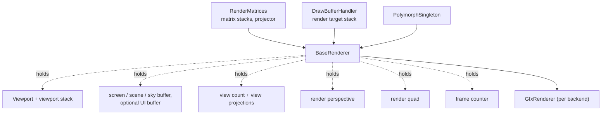

# The Renderer and the Frame

`BaseRenderer` is the library's centre. Everything an application draws goes through it, and almost
everything the library offers is reachable from it. This document describes what it holds, how a
frame is structured, and how coordinates get from a model to a pixel.

## What the renderer is composed of



The two base classes are inherited rather than held, so that a call site reads
`baseRenderer.PushMatrix()` and `baseRenderer.ResetDrawBuffers()`. Both are shared by all three
backends. `DrawBufferHandler` is the subject of
[05-render-targets-and-draw-buffers.md](05-render-targets-and-draw-buffers.md).

The render targets it owns are the fixed points of the frame:

- **scene buffer** - where the 3D world is rendered. It is a stack, not a single value:
  `SetSceneBuffer(rt)` pushes, `SetSceneBuffer(nullptr)` pops. A pass that renders the world
  somewhere else (a camera monitor, a reflection) pushes its own and pops it again.
- **sky buffer** - the background layer.
- **screen buffer** - the 2D composition target, created by `CreateScreenBuffer` at window size with
  one color buffer. While an OpenXR session exists it keeps coverage alpha, because it becomes the
  HUD layer ([10-vr-and-openxr.md](10-vr-and-openxr.md)).
- **UI buffer** - optional, set by the application (`SetUIBuffer`). While one is set it replaces the
  screen buffer as the 2D target: `ScreenTarget()` is the UI buffer or else the screen buffer, and
  `ScreenWidth()` / `ScreenHeight()` are its size or else the window's. `ScreenHasChanged` compares
  a caller's counter with one that `Init` and `SetUIBuffer` raise, so a client knows when to rebuild
  whatever it sized to the screen. What `DrawScreen` puts on the back buffer is the screen target.

The renderer also holds the application's **render perspective** (`SetPerspective`): forward, top
down, respawn overview or free camera. Callers ask the grouped questions rather than comparing
values - `HasExternalView` (the camera is not the player's eye: top down, respawn, free camera),
`HasExternalCamera` (top down) and `HasFreeCamera` (free camera) - and the shadow map uses the
perspective to tell the player's own view from the others.

## Coordinates: matrix stacks and the projector

`RenderMatrices` holds not one matrix stack but an array of `MatrixStack`, selectable by index
(`SelectMatrixStack`, `AddMatrices`). A stack carries the model-view and four projections - the
current one, a 2D one, a 3D one and one for effects - plus a `Projector` that owns the frustum
parameters (`FoV`, `AspectRatio`, `ZNear`, `ZFar`).

Several stacks exist so that a renderer that draws from more than one point of view - a mirror, a
camera monitor, a shadow pass - can switch a whole coordinate system with one index instead of
rebuilding matrices.

Matrices are `basetools`' `Matrix4f`, which every project builds on glm (`USE_GLM=1`) and which is
therefore column-major. `PushMatrix` / `PopMatrix` and `Translate` / `Rotate` / `Scale` are the
familiar fixed-function verbs, preserved deliberately: the application layer was written against them
and they are a compact way to express nested transforms. `SetupTransformation` and
`ResetTransformation` switch between the 3D and 2D setups.

Shaders receive the matrices through `Shader::SetMatrix4f(eBaseMatrices, ...)`, where `eBaseMatrices`
is `bmModelView`, `bmProjection`, `bmViewport`, `bmLightTransform`. These four are addressed by enum
rather than by name because they are the base inventory every shader has; everything else a shader
needs is set by name. See [08-shaders.md](08-shaders.md).

### Views

The renderer carries a view count (`ViewCount`): 1, or 2 while an OpenXR session renders both eyes
at once. It is a mode of the whole process, not a per-draw setting - shaders are compiled with a
multiview prelude for it, pipelines carry the matching view mask, the `b0` block grows from 256 to
640 bytes, and the shader and pipeline caches keep a separate set. It changes only through a VR
switch or a graphics restart.

With two views the per-eye matrices travel next to the ordinary ones. `SetViewProjections`
registers, for a base projection matrix, each eye's projection and view and the inverse of each eye
view (`headFromEye` - eye views need not be rigid, so a shader cannot invert them by transposing).
`Shader::UpdateMatrices` looks up the projection it is drawing with and writes the eye matrices into
`b0`; a projection without an entry draws with the base projection and identity eye views. Entries
are matched by the exact matrix, registering one again moves it to the end, and at most eight are
kept - a projection that changes every frame (a zoom, a field of view ramp) would otherwise grow the
list without bound. `RendersEyeViews` tells whether the current draw goes to the eyes: two views, no
pushed scene buffer, matrix stack 0. The whole mechanism is described in
[10-vr-and-openxr.md](10-vr-and-openxr.md).

## Viewports: a transformation, not a scissor

This is the least obvious decision in the renderer and it shows up everywhere.

`BaseRenderer::SetViewport(viewport, ...)` does **not** set the graphics viewport to the given
rectangle. It sets the graphics viewport to the *whole* active render target -
`gfxStates.SetViewport(0, 0, windowWidth, windowHeight)`, where width and height come from the active
draw buffer if there is one and from the window otherwise - and then builds a transformation matrix
that maps normalized coordinates into the requested rectangle
(`Viewport::BuildTransformation`).

Consequences, all of them architectural:

- **The graphics viewport always covers the entire bound target.** That is an invariant every render
  target activation can rely on, and it is why a render target switch does not have to restore a
  viewport rectangle.
- **A viewport scales, it does not clip.** Geometry outside the rectangle is squeezed into it rather
  than cut off. An application that needs real clipping has to add a scissor; D2X-XL's renderer
  overrides `SetViewport` to do exactly that, which is why the method is virtual.
- **Vertical flip lives here.** `flipVertically` both mirrors the rectangle's top coordinate and is
  passed into the transformation - but only combined with `UsesOpenGL()`, because the flip exists to
  reconcile GL's bottom-left framebuffer origin with the top-left origin of the other two.

`PushViewport` / `PopViewport` keep a static stack. The restore rebuilds the viewport from the stored
rectangle and the target size it was built for; the native viewport snapshot `PushViewport` takes is
not used, and the vertical flip is not restored. An entry larger than both the window and the screen
target is dropped. In debug builds the pushing function's name is recorded in the entry, which is the
fastest way to find an unbalanced push.

## The frame

```mermaid
sequenceDiagram
    participant App as application
    participant DH as DisplayHandler
    participant BR as BaseRenderer
    participant RT as render targets

    App->>DH: BeginFrame (wait for the slot's fence, drain the slot; VK: acquire image)
    App->>BR: Start3DScene
    BR->>RT: activate scene buffer
    App->>BR: ... draw the world ...
    App->>BR: Draw3DScene
    BR->>BR: Stop3DScene + Start2DScene
    BR->>RT: activate screen target (UI buffer or screen buffer, cleared)
    BR->>BR: composite the RenderPostEffect result onto the quad
    App->>BR: ... draw HUD / menus ...
    App->>BR: DrawScreen
    BR->>DH: screen target onto back buffer (VR: also into the HUD layer)
    App->>DH: EndFrame (ExecuteAll, present)
```

**`Start3DScene`** starts the frame counter, applies the default render states (`SetupGraphics`),
resets the draw buffer stack, activates the scene buffer (and fails without one), sets up the 3D
transformation, applies the scene viewport and activates the camera. **`Stop3DScene`** deactivates
them again.

**`Start2DScene`** resets the draw buffer stack, sets the clear color - the background color, or
transparent while an OpenXR session exists, because the screen target becomes the HUD layer - resets
the transformation to 2D, sets the viewport to the screen target's size, applies the 2D render states
and activates the screen target with a clear. If there is no screen target, or it cannot be
activated, the back buffer is enabled and cleared directly. `m_screenIsAvailable` is set in both
cases: it records that a 2D pass is open, not which target it went to. `Stop2DScene` and `DrawScreen`
return at once while it is clear, and a client that activates the screen buffer itself sets it with
`SetScreenAvailable`.

**`Draw3DScene`** is the bridge: it stops the 3D scene, starts the 2D scene, and draws a texture on
the render quad. The texture comes from `RenderPostEffect` - by default the scene buffer itself; an
application that runs its own post-processing chain overrides it and returns the target the chain
ended in. If the application supplies a post effect shader (`UsePostEffectShader` /
`LoadPostEffectShader` - tone mapping an HDR target, for example) the quad is drawn with that
shader, under a matrix that is flipped for OpenGL only. While the VR view is active the scene goes
into the OpenXR eye target instead (with the scene depth handed to the runtime where it takes it),
and the 2D pass that follows starts on an empty, transparent screen target - the HUD.

**`DrawScreen`** (Vulkan and DirectX) ends the 2D pass first - frame counter overlay, `Stop2DScene`,
`UpdateFrameMetrics` (which clears `m_screenIsAvailable` and bumps the frame index) - and then puts
the screen target on the back buffer. With a running OpenXR session it first hands the screen target
to the HUD layer, and the window shows the eye images or the fitted screen target instead of filling
the back buffer (see [10-vr-and-openxr.md](10-vr-and-openxr.md)).

### Render passes

`RenderPassType` is `rpShadows`, `rpColor` or `rpFull`, and `StartShadowPass` / `StartColorPass` /
`StartFullPass` each set a complete, named block of state rather than a single flag:

- **shadow**: depth test and write on, `Less`, color mask off, blending off. The commented-out
  `SetPolygonOffset` is the caster-side slope-scaled depth bias, kept in place with its reasoning.
- **color**: depth test on, depth write *off*, `LessEqual`, color mask on. Depth comes from a prior
  pass.
- **full**: as color, but with depth write on.

Both non-shadow passes explicitly clear the polygon offset, so a shadow pass cannot leak its bias into
what follows. `Set3DRenderStates` and `Set2DRenderStates` are the two ground states; `Set3DRenderStates`
derives its depth write default from the current pass.

*Coverage alpha* exists at two levels. `BaseRenderer::SetCoverageAlpha` is a renderer switch (it
returns the previous value): while it is set, `SetBlendMode(Alpha)` sets the alpha blend factors
apart from the colour factors - source alpha factor one, destination alpha factor that of the mode -
so a target accumulates coverage in its alpha channel instead of the blended alpha.
`RenderTarget::SetCoverageAlpha` (Vulkan and DirectX) does the same per target, when the pipeline
is built: an "over" blend accumulates coverage, an additive blend leaves alpha alone. The screen
buffer uses the target flag while an OpenXR session exists, because its alpha becomes the HUD
layer's.

### Frame-level work outside the renderer

`BaseDisplayHandler` owns the window, the display modes and the swap chain, and it is where a frame
actually begins and ends. It is a `PolymorphSingleton` too, so an application can derive from it -
`RequestDisplayChange` exists for exactly that, because a resolution change has to happen *between*
frames, never inside one.

In Vulkan and DirectX the window is created hidden and centered through SDL3 and shown once its
fullscreen mode is set. The display modes are the primary display's fullscreen modes, largest
first, one per width and height (the highest refresh rate wins; modes with the same pixel count but
a different shape are kept apart). `Create` snaps the requested size to the nearest display mode
unless the caller passes `matchDisplayMode = false`; `UpdateWindowSize` puts the window into windowed
mode at any size up to the desktop, with the nearest display mode remembered for a later switch to
full screen. Both resize the swap chain, so they too belong between frames.

`BeginFrame` waits while the window is minimized - except during an OpenXR session, which has to keep
running - and calls the virtual `OnMinimized` / `OnRestored` around the wait, so an application can
stop its clock for the pause. In Vulkan a frame can also run without a window image (no usable swap
chain, or a minimized mirror window in VR): the slot is waited for and drained as usual, but nothing
is acquired or presented.

The startup order differs per backend and is not hidden, because it cannot be. In Vulkan the device
needs the surface, which needs the window: the window comes first (`BaseDisplayHandler::Create`),
then `InitGraphics`, which creates the device and builds the swap chain itself (`SetupSwapchain`)
once the device exists. DirectX creates its swap chain on the device's command queue inside display
setup, so there `InitGraphics` has to run before `Create` - the opposite order, which the application
chooses with `UsesDirectX()`. `InitGraphics` takes a `GfxFeatureRequest` (see
[02-api-abstraction.md](02-api-abstraction.md)); what the device grants is queried with `HasFeature`.

### Level-load hooks

Three calls belong to a level load rather than to a frame. `PrecreatePipelines` builds the pipelines
recorded in earlier runs (and writes the pipeline cache afterwards when something was new); it takes
an optional progress callback, called before each pipeline, in which the application may draw a
progress display. `ReserveMemory`, called last, makes sure the memory types a frame allocates from
have room to spare, so the driver is not asked for new memory blocks during play (Vulkan only).
`FlushResources` submits and waits for all pending work and gives back everything waiting for a
deferred release - at startup, and also in the middle of a session, e.g. when a level is left.

### Restarting the graphics device

`ShutdownGraphics` takes everything down to the device - after a `FlushResources`, the GPU side of
every registered resource, the shaders' compiled state, the pipeline cache, the descriptor and
constant machinery, the command list infrastructure and the swap chain. `RestartGraphics` builds it
again, sets the view count, recompiles the shaders in place and restores the resources. What makes
this possible without the application rebuilding its objects is `GpuRegistry` (`gpuregistry.h`):
meshes, render targets, textures, GPU arrays, acceleration structures and read targets register
there, release only their GPU side before the device goes and rebuild it from their kept CPU data
and creation parameters afterwards. The renderer, its matrices and viewports and the render target
objects survive. VR needs this to move to a device created through the OpenXR runtime; the details
are in [10-vr-and-openxr.md](10-vr-and-openxr.md).

## Drawing without geometry

Three conveniences on the renderer cover the cases where there is nothing to draw but a rectangle:

- `Render(shader, textures, color)` draws the render quad with the given shader and textures. The
  texture parameter is a `std::span<Texture* const>`, with overloads for a single texture and for a
  braced list - see [06-buffers-and-meshes.md](06-buffers-and-meshes.md) for why.
- `RenderToViewport(texture, color, rotate, flip, shader)` draws a texture into the current viewport,
  optionally rotated by 90 degrees and/or flipped.
- `Fill(color, scale)` fills the current viewport, and `Viewport::Fill` does the same for a viewport
  that is not the current one.

`m_renderQuad` is a `BaseQuadMesh` created once in `Create`. Practically every post-processing step
in either application ends up going through it.

## Backend operations without a pass: `StartOperation` / `FinishOperation`

Work that has to reach the GPU but does not belong to a render pass - a buffer copy, a compute
dispatch, building a font or a skybox - needs a command list in Vulkan and DirectX and needs nothing
at all in OpenGL. `BaseRenderer::StartOperation` / `FinishOperation` is that difference, reduced to a
pair of calls that are valid in all three:

- **OpenGL**: `StartOperation` returns `nullptr`, `FinishOperation` returns `true`. There is nothing
  to open.
- **Vulkan / DirectX**: if a command list is already current, it is used (with a reference count if it
  is a temporary one). Otherwise, with `piggyback` set, the renderer's spare temporary list is joined
  if one is open, and only failing that is a new temporary list created and opened. `FinishOperation`
  decrements the count and closes - or flushes, if the caller needs the work to have finished - when
  it reaches zero.

The piggyback rule lets a sequence of operations outside any list share one temporary list until
somebody asks for a flush. Texture uploads do not go through it; they have their own path (see
[04-command-lists.md](04-command-lists.md), "Where work outside a rendering scope goes"). DirectX
forgets the spare list as soon as it is no longer recording or has been recycled, which its execution
counter tells.

## Instrumentation

`MovingFrameCounter` (`framecounter.h`) measures a moving-average frame rate and can draw itself as an
overlay in a corner viewport, set up in `BaseRenderer::Init`. `GfxStates::CountDraw` / `DrawCount` /
`ResetDrawCount` count every draw the library issues, so an application can read the cost of a pass in
draws - that counter is what batching work is measured against.

Tracy zones are compiled in via `USE_TRACY`: Vulkan and DirectX open a GPU zone per command list, and
`gpuzone.h` adds a scoped GPU zone whose end goes into whatever list is recording when it is left, so
it may span a render target switch. (`gputimer.h` is an OpenGL-only query timer.)

Two compile switches add logs for performance hunts. `LOG_FRAME_METRICS` (`log_frame_metrics.h`, off
by default; Vulkan and DirectX) times every command list on the GPU while an OpenXR session runs and
writes a per-second summary, frames over the display period and the VRAM usage and budget
(`GfxStates::GetMemoryBudget`). `VK_STALL_DIAG` (`vkframework.h`, off by default; Vulkan only)
records waits, one-shot submits, pipeline and resource creation, memory placement and per-pass GPU
times around frames that stall. Applications mark stages inside a list with `GfxStageMark`; it,
`GfxSampleFrame` and `GfxDumpConstants` are free functions the backends define without a header
declaration, and they compile to nothing without the switches.

## Divergences

- Several `GfxRenderer` responsibilities are no-ops in OpenGL by design, through `BaseRenderer`
  defaults: `FlushResources`, `Cleanup`, `LoadPipelineCache`, `SavePipelineCache`,
  `PrecreatePipelines`. `ReserveMemory` is a no-op in DirectX as well, and `ShutdownGraphics` /
  `RestartGraphics` are inline stubs in OpenGL.
- `Draw3DScene` passes `flipVertically = true` in OpenGL and `false` in the other two; the same holds
  for the post effect path, which scales by -1 in Y for OpenGL only.
- `SetGeometryFrontFace` / `SetShadowFrontFace` are inverted between OpenGL (`Reverse` for geometry)
  and Vulkan/DirectX (`Regular` for geometry), and the VK/DX renderers additionally initialize
  `m_frontFace` / `m_backFace` in their constructors where the OpenGL one leaves them at `None`.
- The header comments of `base_renderer.h`, `directx/include/gfxrenderer.h` and
  `opengl/include/gfxrenderer.h` (the latter titled "DX12 Renderer") still describe a DX12 port in
  progress ("SetupOpenGL -> SetupDX12 internally"), as does the block comment at the top of
  `base_renderer.cpp`. `SetupGraphics` is the current name in all three.
- `BaseRenderer::Draw3DScene` guards its quad draw with a function-local `static bool renderScene =
  true` - a debug switch that is never written.
- `MatrixStack`'s comment calls the matrices row-major; with `USE_GLM=1` in every project they are glm
  matrices and column-major. `RenderMatrices::SetMatrix` still mirrors a matrix into the
  fixed-function stack under OpenGL; nothing calls it.
- `UpdateWindowSize`, the minimize wait and the SDL3 window creation exist in Vulkan and DirectX only;
  the OpenGL display handler declares `OnMinimized` / `OnRestored` but never calls them.
- `SetVSync` rebuilds the swap chain in Vulkan (the present mode belongs to it) and only stores the
  flag in DirectX, where it selects the sync interval and the tearing flag at present time.
- DirectX needs `InitGraphics` before `BaseDisplayHandler::Create`, Vulkan and OpenGL after it.
