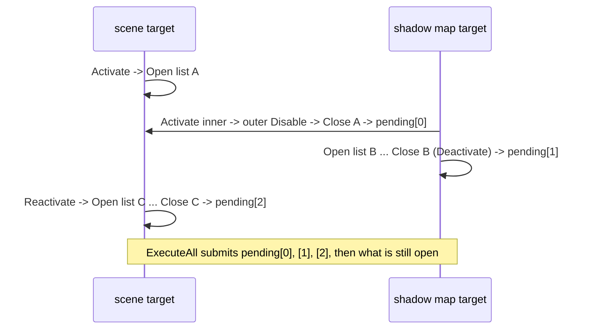
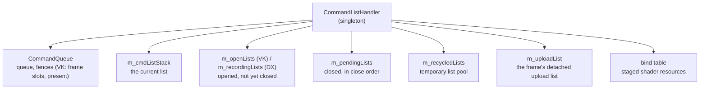

# Command Lists and Render Tasks

OpenGL has no command lists: a call reaches the driver when it is made. Vulkan and DirectX 12 record
work into a buffer that is submitted later, and everything about ordering, lifetime and
synchronization follows from that. This document describes the model the library imposes on both, so
that the layer above does not have to know which of the two it is talking to.

The model is DX12-shaped and Vulkan follows it idiomatically, because DX12's command list is the more
constrained of the two and anything that satisfies it also satisfies Vulkan.

## One render task, one command list

The central rule:

> **A render task lives strictly between `Open()` and `Close()`. Tasks are not nested. The execution
> order is the CLOSE order - whichever list is closed first is submitted first.**

A render task is one `RenderTarget::Enable` -> draws -> `RenderTarget::Disable` scope. It maps onto a
DX12 command list with one set of render targets bound, and onto a Vulkan command buffer that holds
one or more `vkCmdBeginRendering` scopes on the same target (a scope is ended and reopened around
copies, see "Suspending a rendering scope").

Close order rather than open order is what keeps submission in recording order. A render target's
list is never nested inside another target's: activating an inner target disables the outer one,
which closes its list, and when the inner one is deactivated the outer target is reactivated with a
fresh list. One activation scope in the source can therefore produce several lists - the part before
the inner scope, the inner scope, the part after it - and they close, and run, in exactly that order:
render the shadow map, then use it. A list that does stay open underneath others is the back
buffer's in Vulkan (see "The list stack and the current list"); it closes last.

## The pieces

**`CommandList`** owns one command allocator (DX) or command pool (VK) *per frame slot*. Vulkan
allocates one command buffer from each pool; DirectX has a single command list that `Open()` resets
onto the active slot's allocator. `Open()` resets the slot's pool or allocator and begins recording;
`Close()` ends recording and registers the list for submission; `Flush()` submits it immediately,
with the frame's upload list in front of it, and waits. DirectX also has `Submit()`, which sends a
list at once without waiting (the top level acceleration structure build without enhanced barriers).

It also carries what has to be remembered across a list's lifetime: its id and name, an execution
counter, a reference count (for the piggybacking described in
[03-renderer-and-frame.md](03-renderer-and-frame.md)), the currently bound pipeline and topology, a
list of disposable resources, and its GPU profiling zone.

**`CommandListHandler`** is the singleton that routes everything. It owns the `CommandQueue`, the
stack of currently active lists, the open and pending lists, the pool of recycled temporary lists,
the frame's upload list and the per-draw bind table, and it submits (`ExecuteAll`,
`ExecutePending`). The frame slot belongs to the handler in DirectX (`BeginFrame`, `EndFrame`,
`Flush`) and to the `CommandQueue` in Vulkan.

**`CommandQueue`** owns the actual queue and the per-slot fences; with `FRAME_COUNT = 2` it
double-buffers. In Vulkan it also drives the frame: `BeginFrame` waits for the slot's fence, resets
the slot's per-frame resources (deferred releases, descriptor pools, constants ring) and then
acquires a swap chain image - or skips that for a frame without a window image - and `EndFrame`
presents (when an image was acquired) and advances. In DirectX the handler's `BeginFrame` advances
the slot and waits, `EndFrame` signals the fence, and the display handler presents.

The Vulkan semaphore indexing is worth noting as an example of what the abstraction cannot hide:
`imageAvailable` and the in-flight fence are indexed by *frame slot*, but `renderFinished` is indexed
by *swap chain image*, because the driver may return acquired image indices in any order and a
slot-indexed signal semaphore could be re-signalled while its previous image is still pending
presentation.

The acquire semaphore has to be waited for by the first submit that touches the acquired image, and
that is not always the frame submit: a setup-phase drain, a mid-frame readback or a flushed list can
carry back buffer commands too. Every list that records into the back buffer is marked
(`m_usesBackBuffer`), the queue remembers that an acquire wait is pending (`TakeAcquireWait`), and
the first submit with a marked list takes it; the frame submit waits only if nobody did. The swap
chain images' layout trackers start at the color attachment output stage, so their first transition
is ordered after that wait.

## The list stack and "the current list"

`PushCmdList` / `PopCmdList` maintain a stack; `CurrentCmdList()` is its top. Everything that records
work - a draw, a barrier, a copy - asks the handler for the current list rather than being handed one.

Two consequences:

- **The back buffer brings its own list.** The bottom of the stack is not a list held for the whole
  frame but the back buffer's (`BaseDisplayHandler::BackBufferList`), opened on demand by the first
  thing that records with no list current - `EnableBackBuffer`, or a shader activated while the draw
  buffer stack is empty. Vulkan keeps it open underneath the render targets' lists until the frame
  end; DirectX closes it whenever a render target becomes the draw buffer and opens a new one when
  the back buffer is enabled again. A draw with no recording list at all records nothing. A device
  loss is detected after every submit, wait and present and ends the program with a message - there
  is no recovery.
- **Every render target opens its own list** in `Enable` - taken from the temporary pool - and closes
  it in `Disable`, or when an inner target takes over (see above). So a draw inside an
  `Enable`/`Disable` scope lands in that target's list, and a draw outside any scope lands in the back
  buffer's list. Nobody passes a list around.

A *detached* list is the exception: it registers itself for submission at `Open`, does not join the
stack and saves no render states. Its one use is the frame's upload list (`UploadCmdBuffer` in
Vulkan, `UploadCmdList` in DirectX): registered when it is opened, it runs ahead of every list closed
after that - in front of the draws that read what it uploads, whichever list they are in.

## Temporary lists and their pool

Work outside a render pass uses a temporary list, obtained through
`CommandListHandler::CreateCmdList` or, at the renderer level, `StartOperation`.

Temporary lists - render targets' lists included - are pooled in `m_recycledLists` and go back after
`ExecuteAll` or `ExecutePending`. The pool's invariant: **a list in the pool has been executed and is
closed** - a defined end state, so a list taken from it can be opened without checking what happened
to it before. A holder that keeps a pointer across a submit has to check whether the object has been
reused since; the execution counter, raised on every `Open()`, tells.

## Submission

`ExecuteAll` runs once per frame, inside `BaseDisplayHandler::EndFrame`, before the present:

1. anything still recording is forced closed (which registers it);
2. the pending lists not already flushed are submitted **in close order** - one `vkQueueSubmit2` in
   Vulkan (waiting for the acquired image unless an earlier submit has, signalling the present
   semaphore when there is an image, and the slot's fence), one `ExecuteCommandLists` in DirectX;
3. the pending list is cleared and the temporaries are recycled.

Vulkan's `ExecuteAll(true)` is the setup-phase variant: no present semaphore, no fence, a wait for the
queue afterwards.

`ExecutePending` (both backends) is a partial variant: it closes the upload list, submits what has
been closed so far and waits for it, leaving lists that are still recording alone. It then releases
what the deferred cleanup holds for the current slot - except what a list still recording may use -
and resets the bindings. It exists for CPU readbacks in mid frame (render target and back buffer
reads, buffer writes) and for releasing a render target immediately.

`BaseRenderer::FlushResources` closes the back buffer's list, submits everything and waits for the
queue (DirectX: the handler's `Flush`; Vulkan: `ExecuteAll(true)`), then releases what waits in every
frame slot's deferred cleanup and resets the bindings. It is the setup-phase path, where there is no
frame fence yet, and it is valid in the middle of a session as well (an application calls it when a
level is left); Vulkan drains the current slot last so the resource handler stays on the active
frame. `BaseRenderer::Cleanup` is the shutdown counterpart: wait idle, save the pipeline cache, drain
the deferred cleanup, release the default resources - before the general resource handlers are torn
down. Both are no-ops in OpenGL.

## Resource lifetime: deferred destruction

A resource dropped in mid-frame may still be referenced by command buffers the GPU has not finished
with. Destroying it immediately is a use-after-free on the GPU side.

`GfxResourceHandler` solves this with deferral per frame slot: what is dropped is registered against
the currently active slot and released the next time that slot becomes active - after that frame's
fence has signalled, at which point the GPU is provably done. With two frame slots that is a deferral
of one full frame. Vulkan registers a lambda (`TrackCleanup`); DirectX registers the resource or
descriptor handle itself (`Track`), and upload buffers go back to a pool of their own (`TrackUpload`)
instead of being freed. Every entry carries a serial: a drain that runs while lists are still
recording (mid-frame readback, DirectX's frame start) releases only what was dropped before the
oldest of them was opened.

It is used for every resource that can outlive its owner by a frame: texture destruction and the
upload path's image replacement, render target buffer release, linear texture updates, buffer
destruction, bindless heap indices.

Two details that the class comments make explicit and that matter for anyone adding a resource type:

- **Deferral applies to every texture, not only to short-lived ones.** A caller may drop a long-lived
  texture in mid-frame just as well.
- **The handler can die before its clients.** Objects with static storage duration are destroyed in an
  order nobody controls, and some of them own GPU resources. In Vulkan `s_isAlive` makes
  `TrackCleanup` fall back to running the lambda inline once the handler is gone - by then the GPU is
  idle anyway. DirectX uses the opposite guard: `BeginShutdown`, called from `Cleanup`, makes tracking
  inert, and releases at teardown drop their resources directly. `GfxStates` carries the same kind of
  guard (`IsDestroyed`) for the same reason: its binding lists are gone while textures are still
  dropping their bindings.

A render target that must make room for its replacement can be destroyed immediately
(`RenderTarget::Destroy(true)`): pending lists are executed, the queue is drained, the buffers leave
the bindings and are freed at once - in Vulkan through `GfxResourceHandler::CleanupNow`, which also
raises the cleanup generation so no cached descriptor set still names a destroyed view. The caller
guarantees that no list still recording uses the target.

A command list has its own, narrower version: `AddResource` attaches a disposal lambda to the list,
fired by `DisposeResources` - which only `Flush` calls, so it suits lists that are flushed. Nothing in
the library uses it at present.

## The bind table

Neither Vulkan nor DirectX binds a texture the way OpenGL does. The library gives both the OpenGL
shape at the call site - `Texture::Bind(slot)` - and stages the result:

`Texture::Bind`, `RenderTarget::BindBuffer` and `GfxArray::Bind` write into a CPU-side table on the
handler, at the logical `t`/`s`/`u` slot. Right before each draw, `Shader::UpdateVariables`
materializes that table: in Vulkan into a `VkDescriptorSet` (allocated from `descriptorPoolHandler`,
written with `vkUpdateDescriptorSets`, bound with the b0/b1 dynamic offsets), in DirectX into
descriptor tables. Neither rebuilds what has not changed: a Vulkan shader binds its last set again
when the resolved handles, the descriptor pool generation (new per frame slot) and the cleanup
generation (new whenever a deferred release has run) are unchanged; DirectX rebuilds a table only
when its binding version or the table generation moved.

The slot counts are fixed and mirrored on the shader side, checked by static asserts: 24 sampled
images (t0..t23), 24 samplers, 4 UAVs, 24 read-only storage buffers (t0..t23 space1), one
acceleration structure (t0 space2; a shader that declares one refuses to draw without it), and 16
per-instance vertex streams. Only slots a shader declares are filled. A declared slot that nobody
bound gets a default - an image of the declared view type, the default sampler, a small default
buffer (DirectX: null descriptors) - because an unwritten descriptor the shader reads is invalid. The
bindless texture heap, where the device has it, is not part of the table: it is one long-lived
descriptor set (Vulkan set 1) or a group of root tables, bound behind the table for shaders that read
it (see [07-textures-and-samplers.md](07-textures-and-samplers.md)).

`ResetBindings` invalidates everything at frame start and after every drain. `UnbindBuffer` clears
every slot a given buffer occupies, and `UnbindImage` every slot an image view occupies - without them
a resource destroyed while still bound would leave the table pointing into memory that is being freed,
and the next draw would write that into a descriptor set. A render target buffer is unbound when it
becomes an attachment (it must not be sampled while it is written) and whenever it is released.

## Suspending a rendering scope

Vulkan forbids a copy or a fill inside an open `vkCmdBeginRendering` scope, and forbids a second
scope inside one. Two mechanisms handle that:

- **`SuspendRendering` / `ResumeRendering`** close the scope on the current command buffer and reopen
  it with its contents preserved. For work that has to stay in recording order. `RenderingScope`
  remembers whether the suspended scope belonged to a render target or to the back buffer.
- **The frame's upload list** (`UploadCmdBuffer`) is the alternative for work that may run ahead of
  the frame: a detached list outside anybody's rendering scope, registered when it is opened and
  therefore submitted in front of every list closed after that.

The back buffer has its own version of the same problem, and `BaseDisplayHandler` carries the state
for it: `SuspendBackBuffer` closes the scope and leaves the image as a color attachment (what a render
target becoming the draw buffer needs), while `DisableBackBuffer` also transitions it to
`PRESENT_SRC`. `m_backBufferWasWritten` decides the load operation of the *next* scope on the back
buffer: the first scope in a frame discards the old content, every later one loads it - otherwise a
render target activated in between would cost everything already drawn on the screen.

In DirectX, `SuspendBackBuffer` closes the back buffer's own list, so that copies and compute passes
recorded on the back buffer before a render target was activated run before that target's draws; the
next `EnableBackBuffer` opens a new list. The render states saved by the first back buffer list of a
frame are restored once, by the last one closed. `CloseBackBufferList` (both backends) transitions the
back buffer to present and closes its own list; it runs before any drain or readback that has to
include the back buffer's commands, and at the frame end.

`BackBufferList()` closes the circle: the back buffer is the bottom of the render target stack and
needs a command list like any other target, so it opens one of its own when no other list is current.

### Where work outside a rendering scope goes

Inside a frame, every texture upload records onto the frame's upload list, in both backends, and the
staging memory goes back through the deferred cleanup; the texture is usable by the frame that asked
for it, because the upload list runs first. A buffer copy that must stay in recording order goes into
the recording list (Vulkan suspends the rendering scope around it), and while the draw buffers are
suspended into an ordered copy list of its own, closed - and so ordered - at once. An unordered copy
may take the upload list. Outside a frame an upload is submitted on the spot and waited for: a
one-shot command buffer in Vulkan, a flushed temporary list in DirectX. Nothing waits for the queue in
the middle of a frame.

## OpenGL

There is no `CommandList` in the OpenGL backend, and no `CommandListHandler`, `CommandQueue`,
`GfxResourceHandler`, `cbvAllocator` or descriptor machinery. The interfaces that exist for their sake
are `BaseRenderer` virtuals that default to doing nothing, and `RenderTarget::Enable` / `Disable`
simply bind and unbind a framebuffer object.

The asymmetry is not hidden anywhere else, which is deliberate: an OpenGL build pays nothing for
machinery it does not need, and the shared layer never mentions it.

## Divergences

- The DirectX comments on `m_pendingLists` and `ExecuteAll` say lists are registered at `Open()` and
  that `ExecuteAll` only warns about lists still open. `Close` registers ordinary lists in both
  backends (only the detached upload list registers at `Open`), and `ExecuteAll` force-closes what is
  still recording. Only the Vulkan comments describe this correctly.
- `SuspendRendering` / `ResumeRendering`, `m_backBufferWasWritten` and the acquire-wait tracking exist
  in the Vulkan backend only. The DirectX backend tracks `m_recordingLists` instead of `m_openLists`.
- The back buffer's list: Vulkan keeps it open underneath render target lists until the frame end
  (`SuspendBackBuffer` only ends the rendering scope); DirectX closes it whenever a render target
  becomes the draw buffer.
- Both `CommandList`s keep a static render state stack with `PushRenderStates` / `PopRenderStates`
  around `Open` / `Close`, so a list restores the render state its opener had. When `ExecuteAll`
  force-closes a list still recording at the frame end, DirectX restores only the states the list
  saved (`m_savedRenderStates`); Vulkan closes it with the default, which restores.
- `CommandList::Submit` (send without waiting) exists in DirectX only.
- `Cleanup` destroys the command list infrastructure in DirectX only; Vulkan leaves that to
  `ShutdownGraphics`.
- `GfxRenderer::StartOperation` in DirectX forgets a spare temporary list that has stopped recording
  or was recycled; Vulkan does not check.
- Immediate release goes through `GfxResourceHandler::CleanupNow` in Vulkan; DirectX frees the
  descriptors to their heaps directly.
- `vulkan/include/dx12context.h`, `vulkan/include/dx12framework.h`, `vulkan/include/dx12upload.h` and
  `vulkan/src/dx12context.cpp` are DirectX files sitting in the Vulkan tree. They are referenced by
  neither `vulkan/visualstudio/rendertools.vcxproj` nor the Vulkan Makefile.
