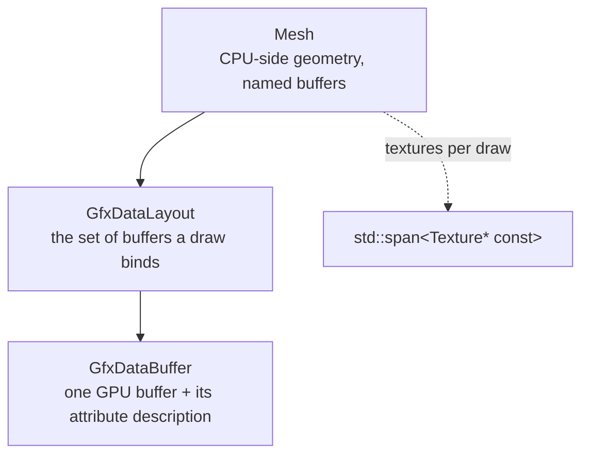

# Buffers, Layouts and Meshes

Geometry reaches the GPU through three layers, each with one job:



`Mesh` and the CPU-side buffers are shared by all three backends; `GfxDataLayout`, `GfxDataBuffer`,
`GfxArray` and `MeshHandler` exist once per backend.

## `GfxDataBuffer` - one stream

A `GfxDataBuffer` is one vertex attribute stream or one index stream. It carries its GPU resource,
its element geometry (component type, component count, item size, item count), a dynamic flag, and
two tags: a `const char*` type name ("Vertex", "TexCoord", "Normal", ...) and an integer id for the
types that exist several times.

`Update(type, bufferTarget, index, data, dataSize, componentType, componentCount, forceUpdate)` is
the single entry point: it (re-)creates the GPU resource if needed and uploads.

The `index` parameter is the **attribute slot**, and that is where the shared registry comes in.

### The attribute slot registry

`include/shaderdatalayout.h` maps a `(type, id)` tag to a fixed, engine-wide slot:

| Slot | Attribute | | Slot | Attribute |
| --- | --- | --- | --- | --- |
| 0 | Vertex | | 7-10 | Offset/0-3 |
| 1-3 | TexCoord/0-2 | | 11-12 | Float/0-1 |
| 4 | Color | | 13-14 | Uint/0-1 or Offset/4-5 |
| 5 | Normal | | | |
| 6 | Tangent | | | |

Slots 13-14 are shared: a mesh and its shader use them either for `Uint/0-1` or for `Offset/4-5`,
never for both. Slots are bound per mesh and declared per shader, so two consumers that use the same
slot for different attributes do not get in each other's way.

The slot means the same thing in each backend: a GLSL `layout(location = N)`, a Vulkan
`VkVertexInputAttributeDescription` location (HLSL `[[vk::location(N)]]`), and a DX12 input assembler
slot. The consequence is the decision: **shaders address buffers by slot, not by the order a mesh
created them in.** A mesh with only vertices and normals uses slots 0 and 5, and a shader that reads
those two works with it unchanged.

A slot the active shader declares but the mesh does not supply is not left unbound in Vulkan and
DirectX: `GfxDataLayout::Enable` binds a shared default stream there - zeros, or (0, 0, 0, 1) for a
four component attribute - at least as long as the draw's vertex count, so the shader reads a defined
value.

15 slots are used, and the table must stay below 16 - that is what OpenGL and Vulkan guarantee. An
unknown tag returns -1 and its buffer is skipped.

A second function, `GfxAttributeSemantic`, maps the same tag to an HLSL semantic name and index
(`POSITION`, `TEXCOORD`, `COLOR`, `NORMAL`, `TANGENT`, `OFFSET`, `FLOAT`, `UINT`). DirectX matches
attributes by semantic rather than by slot, so both mappings have to exist and agree.

`ShaderDataLayout` / `ShaderDataAttributes` is the declaration side: a shader source states which
attributes it expects, in which format, and whether an attribute advances per vertex or per instance
(`perInstance`). DirectX builds its `D3D12_INPUT_ELEMENT_DESC` array from it, Vulkan one vertex input
binding and attribute per declared slot; OpenGL ignores it.

### Integer attributes

An integer attribute must not be passed as a float. OpenGL needs `glVertexAttribIPointer` rather than
`glVertexAttribPointer` - with the wrong one a `uint` shader input reads a converted value or
garbage. `GfxDataBuffer::IsIntegerAttrib` decides, and that is why slots 13-14 ("Uint") are a separate
attribute type rather than floats that happen to hold integers.

### The backend implementations

**OpenGL** is the thin one: a buffer name, `glBindBuffer`, `glVertexAttribPointer` (or
`glVertexAttribIPointer`), and the address of the data last uploaded (`m_data`, not a copy), by which
`Render` tells an indexed draw from a non-indexed one. Handles are reference-counted through
`SharedGfxHandle`, so a copied buffer shares the GPU object rather than duplicating or leaking it.

**Vulkan and DirectX** have a problem OpenGL does not: a buffer written this frame may still be read
by a draw the GPU has not finished. Both solve it the same way, and it is the most intricate piece of
the buffer layer.

Each `GfxDataBuffer` owns `FRAME_COUNT` (2) buffer slots. A dynamic buffer writes the slot belonging
to the current frame index; a static buffer uses slot 0. But rotation alone is not sufficient, and the
reason is worth stating precisely:

> **A buffer is drawn from the slot its last `Update` wrote, in every frame until the next `Update` -
> not only in the frame it was written in.**

So a buffer that is updated rarely (a level mesh's index buffer, rewritten only when the batch layout
changes) is still being drawn from in the previous frame, out of the very slot this frame's index
picks next. The in-flight fence covers the frame with *this* index, never the one in between.

The bookkeeping that follows from it records when a slot was last *drawn from*, not when it was
written: `GfxDataLayout::Enable` stamps every vertex and index buffer it binds - the default streams
included - with the current frame number (`MarkBound`). `Update` writes a slot in place unless that
slot was bound within the last `FRAME_COUNT` frames; then it takes a fresh buffer and defers the old
one's destruction through `GfxResourceHandler` (see [04-command-lists.md](04-command-lists.md)).
Static buffers, which always use slot 0, follow the same rule: one that has not been drawn from
recently is rewritten in place. Two updates of the same buffer within one frame hit it as well - the
second takes a fresh buffer only if a draw has bound the first one in between.

The rule is selected by `OPTIMIZE_BUFFER_REUSE` in each backend's `shader_loading.h`, which is 1. With
0 the previous, more conservative rule is compiled: each slot records the frame in which it stopped
being the live one (`m_slotRetiredFrame`), a slot is written in place only when it is not the live one
and the frames in flight since then have passed, and a static buffer that already holds data always
gets a fresh one.

Vulkan backs a data buffer with `GfxBuffer` (a `VkBuffer` plus a VMA allocation, persistently mapped
and host-visible), so there is no CPU mirror - writes go straight into mapped memory. The
`Bind` / `Release` / `EnableAttribs` / `Describe` methods are kept as no-ops so that the shared
`GfxDataLayout` code compiles unchanged; the actual `vkCmdBindVertexBuffers` is emitted by
`GfxDataLayout::Enable`.

## `GfxDataLayout` - the set a draw binds

A `GfxDataLayout` holds a list of data buffers plus one index buffer, the topology, an instance count,
and (in OpenGL) a vertex array object handle. It is what `Enable` / `Disable` bracket around a draw,
and `Render` is what issues it.

Three things about it are structural:

**It is stacked, not just current.** `Activate` pushes the previously active layout and makes this one
active; `Deactivate` pops and reactivates the previous one if it is still bound. So a draw nested
inside another draw's setup - which happens in the text and effect renderers - restores what it found.

**`Render` takes an index range.** `Render(textures, firstIndex, indexCount)` draws part of the index
buffer, with `indexCount == 0` meaning "to the end". Without it, a consumer that keeps several batches
in one mesh - a model whose faces are grouped by texture - would need a mesh per batch, which is a
state change and a set of buffers each. This is the mechanism that makes texture batching possible at
the level above.

**Buffer lookup is by tag.** `UpdateDataBuffer(type, id, buffer, componentType, forceUpdate)` finds
the buffer with that `(type, id)` tag or creates it, and resolves the attribute slot through the
registry. A caller never holds a buffer index.

**Instances can come from a stream of their own.** An attribute a shader declares with `perInstance`
advances once per instance. Its data comes from a `GfxArray` with the storage tag `InstanceBuffer`,
bound to the attribute's registry slot with `BindInstanceStream(type, id)`; `Enable` binds it there
when the mesh has no buffer of its own on that slot. The binding is part of the bind table and is
reset with it at the start of every frame, so it is set per frame.

**`RenderIndirect` draws many index ranges in one call.** It takes a range of `GfxDrawCommand`
records - index count, instance count, first index, base vertex, first instance - from a
`GfxDrawCommandBuffer`, a `GfxArray` with the storage tag `IndirectBuffer` that shaders can also write
as a storage buffer. All commands of a call share the shader, the render states, the textures and the
layout's vertex and index buffers. The device feature `MultiDrawIndirect` is part of the default
required set; DirectX creates its command signature with the command list handler.

A draw whose shader constants or descriptor set could not be set up is not recorded, rather than
running with whatever the previous draw left bound; DirectX also skips a draw whose pipeline state
cannot be resolved. Instance streams and indirect draws exist in Vulkan and DirectX only.

`GfxStates::CountDraw` is called from `GfxDataLayout::Render` and `RenderIndirect` (once per call,
whatever the command count), so the draw counter counts exactly the draw calls the library issues.

## Textures in a draw: spans

Every drawing entry point in the library takes its textures as `std::span<Texture* const>`:

```
GfxDataLayout::Render (std::span<Texture* const> textures, ...)
Mesh::Render          (std::span<Texture* const> textures, float alpha)
BaseRenderer::Render  (Shader*, std::span<Texture* const>, const RGBAColor&)
```

with convenience overloads on top: `Mesh::Render` and `BaseRenderer::Render` also take a single
`Texture*` or a `std::initializer_list<Texture*>`, so a call site can write
`mesh.Render({ diffuse, normal, gloss })`; `GfxDataLayout::Render` has only the single texture one.

The reasons this is a span rather than an array or a container:

- **It binds nothing.** A caller can pass an `AutoArray` (`TextureArray`), a C array, a single pointer
  or a braced list, and meshes that carry their own texture stack pass that. A `TextureList`
  (`List<Texture*>`) wraps a linked list and has to be copied into an array first.
- **The position in the span *is* the slot.** `EnableTextures` walks the span and activates texture
  *i* on texture unit *i*. A null entry leaves that slot out of the draw - Vulkan and DirectX clear
  the bind table entry, OpenGL skips the unit - which lets a caller leave a slot empty without building
  a different span.
- **No allocation and no ownership.** A draw does not own the textures it binds, and a span says
  exactly that.

The single-texture overload takes the address of its parameter and wraps it in a one-element span,
which is why it is written as a small inline rather than being folded into the span version.

On the backend side the span is where the abstraction diverges again: OpenGL's `Texture::Activate`
binds to a texture unit immediately, while Vulkan and DirectX write into the bind table described in
[04-command-lists.md](04-command-lists.md) and the descriptor set is materialized right before the
draw. The OpenGL backend keeps `ActivateTextures` / `DeactivateTextures` as aliases of
`EnableTextures` / `DisableTextures` purely so the three backends spell it the same way.

The textures stay bound after the draw: `Render` releases nothing, so the binding state carries over
to the next draw, and a slot a later draw does not assign keeps what it had - a fault in that draw's
setup that the library deliberately does not paper over.

## `Mesh` - the CPU side

`Mesh` is shared code. It owns the CPU-side buffers, each in the type that suits it:

| Member | Type |
| --- | --- |
| vertices, normals, offsets | `VertexBuffer` |
| texture coordinates (3) | `TexCoordBuffer` |
| tangents | `TangentBuffer` |
| vertex colors | `ColorBuffer` |
| indices | `IndexBuffer` |
| float / uint streams | `FloatDataBuffer`, `UintDataBuffer` |

All of them derive from `VertexDataBuffer<APP_DATA_T, GL_DATA_T>`, which keeps two representations: a
`SegmentedList` of the application's own type (`Vector3f`, `TexCoord`, `RGBAColor`) for building, and
a flat `AutoArray` of the GPU type for uploading. The split exists because building geometry wants a
growable container of meaningful elements while an upload wants one contiguous block of floats, and a
dirty flag says when the second has to be rebuilt from the first. `SegmentedList` grows without moving
what is already in it; today it is an alias of the linked `List`, and the segment size the
constructors take is unused. The flat array can also be filled directly (`SetGLData`, `CopyGLData`,
`GfxData()`), bypassing the application side: a buffer without application data keeps its flat data
when it is set up, and `Mesh::UpdateTangents` works from the flat arrays.

`Mesh::UpdateData` walks the buffers and pushes each one into the layout under its tag. The per-buffer
`UpdateXBuffer` methods are the individual half of the same.

### The buffer composition mask

`eMeshBufferBits` is a bit per potential mesh buffer: bit 0 is the index buffer, and the bits after it
follow the attribute slot registry (`Vertex` 1, `TexCoord/0-2` 2-4, `Color` 5, `Normal` 6, `Tangent`
7, `Offset/0-3` 8-11, `Float/0-1` 12-13, `Uint/0-1` 14-15); `mbOffset4` and `mbOffset5`, which share
slots 13-14 with `Uint/0-1`, are appended at the end, so the older bits keep their values.
`m_meshBufferMask` records what a concrete mesh actually has and is rebuilt by `UpdateData`. The same
bits name the buffers that are rewritten often (`m_dynamicBuffers`): `GfxDataLayout::SetDynamic` makes
exactly those `GfxDataBuffer`s dynamic, so they rotate their slots per frame.

The mask exists above all for `MeshHandler`, which pools meshes that are rebuilt every frame (text
meshes above all). `AllocMesh(mask)` hands out a *free mesh with exactly that buffer composition*
(0 matches any), with its CPU buffers reset and its GPU buffers kept for reuse, so a recycled mesh
never has a buffer the caller does not want or misses one it does.

The pool's lifetime rule is the same one that governs everything else in Vulkan and DirectX:
an allocated mesh is parked in the used list of the current frame slot; when that slot comes round
again `FRAME_COUNT` frames later, its GPU work has passed the fence and the parked meshes move back
to the free list. Reclaiming is lazy - the first allocation of a new frame does it - so no per-frame
hook is needed. The caller must not delete a pooled mesh. `MeshHandler` exists once per backend; the
OpenGL one is a stub without a pool that hands back one shared mesh, reset, with the requested buffers
marked dynamic.

`AbstractMesh` is the interface the mesh hierarchy is built on: `Create`, `Destroy`, `Update`,
`Render`. The concrete meshes - `IcoSphere` with its variants, and `BaseQuadMesh`, a `Quad` that is
also a `Mesh` - derive from `Mesh`; `Quad`, `Cube` and `LineSegment` themselves are plain geometry
classes. All are covered in [09-components.md](09-components.md).

`Mesh` and `GfxArray` are `GpuResource`s (`include/gpuregistry.h`), like the Vulkan and DirectX render
targets: when the graphics device is restarted they release only their GPU side and rebuild it
afterwards from what they keep on the CPU - a mesh re-uploads its buffers through `UpdateData`, a
`GfxArray` uploads its CPU copy. A mesh registers when its layout is created. A Vulkan `GfxBuffer`
remembers the device generation it was created on and counts as invalid on a newer device instead of
being freed there. See [10-vr-and-openxr.md](10-vr-and-openxr.md).

## Storage buffers: `GfxArray`

`GfxArray<DATA_T, STORAGE_T>` is a GPU buffer with a CPU copy (`m_data`) that shaders read and write
outside the vertex streams. `STORAGE_T` is one of the `GfxTypes` tag structs and says what the buffer
is for:

| Tag | Use |
| --- | --- |
| `UavTexture` | read-write 2D data - the decal depth buffer is the canonical user |
| `StructuredBuffer` | records, read-write or read-only |
| `InstanceBuffer` | a per-instance vertex stream (see `GfxDataLayout`) |
| `IndirectBuffer` | draw records for `RenderIndirect` (`GfxDrawCommandBuffer`) |

The tag decides the resource kind only in DirectX: `UavTexture` is an `R32_UINT` texture with a UAV,
every other tag a structured buffer with a UAV and a read-only SRV. Vulkan makes all of them a flat
storage buffer of `DATA_T` elements and only adds the vertex buffer or indirect usage for the last
two; a 2D array is indexed as `y * width + x` in the shader. The choice of a storage buffer over a
storage image is documented in the header and is a good example of the kind of decision the
abstraction does not force: it avoids the `GENERAL <-> TRANSFER_DST` layout transitions around every
clear, lets the clear be a `vkCmdFillBuffer` (much faster than `vkCmdClearColorImage`), and keeps
atomics working the same way. `Clear` assumes 32 bit elements in both backends; DirectX clears a
structured buffer through a typed `R32_UINT` view of its own, because the clear is not valid on a
structured view. OpenGL knows only the first two tags and creates a shader storage buffer for either.

A buffer is bound in one of three ways: `Bind` as a read-write buffer (4 slots), `BindReadOnly` as a
read-only structured buffer at `t0..t23 space1` (24 slots, for graphics and compute shaders alike;
DirectX only for the buffer tags), or `BindInstanceStream` as the per-instance stream of an attribute
slot. Read-only structured buffers are the library's path for bulk read-only shader data - Vulkan
rejects a writable storage buffer in the vertex stage unless the device was created with
`vertexPipelineStoresAndAtomics`. OpenGL binds read-only exactly like read-write.

Uploads use per-frame-slot staging buffers for exactly the reason `GfxDataBuffer` rotates its slots:
a staging copy recorded into a command list runs at submit, so the next frame's memcpy must not
overwrite it. Within one frame an upload that overlaps a range already staged takes a staging buffer
of its own, while disjoint ranges (`UploadRange`) share one. The copy is fenced on both sides - before
it against the shaders that read the buffer last, the frame still in flight included, after it
against the shaders of this frame; Vulkan spells out both barriers, DirectX gets the first one from
the transition into the copy state. `UploadImmediate` uploads in a submission of its own. `Download`
drains the queue; `DownloadAsync` records the copy into the list that is recording and hands it to a
`GfxReadTarget`, which is polled like a render target readback.

`Create` takes a `pinned` flag for the buffers shaders read for every pixel of every frame: Vulkan
puts them into one block of device local memory that is never given back or grown
(`VKContext::PinnedPool`, 64 MB) and falls back to the common memory when it is full; DirectX gives
the committed resource the maximum residency priority. OpenGL ignores the flag.

## Divergences

- **`GfxArray` differs substantially in size and shape between the backends** (179 lines in OpenGL,
  715 in Vulkan, 907 in DirectX). The OpenGL version has the least to do - no staging, no layout, no
  descriptor - and the DirectX one the most. OpenGL has no `DownloadAsync`, no instance streams, no
  `InstanceBuffer` / `IndirectBuffer` tags and no `GfxDataLayout::RenderIndirect`; its `BindReadOnly`
  is `Bind`, `UploadImmediate` is `Upload`, and `pinned` is ignored.
- The storage tag selects the resource kind only in DirectX; in Vulkan `UavTexture` and
  `StructuredBuffer` produce the same storage buffer, and the header still calls it a flat `R32_UINT`
  buffer although the element type is `DATA_T`.
- Vulkan records a draw even when `ResolveDrawPipeline` fails - `GfxDataLayout::Render` and
  `RenderIndirect` do not check its result; DirectX skips such a draw.
- The previous slot rule of `GfxDataBuffer` stays in the source under `OPTIMIZE_BUFFER_REUSE` 0, and
  its members (`m_liveSlot`, `m_slotRetiredFrame`) are still declared in Vulkan and DirectX.
- The Vulkan and DirectX `GfxDataBuffer` keep a `char* m_data` that is never used there.
- `GfxDataBuffer::Reset` (OpenGL) and `Clear` (Vulkan, DirectX) are the same operation under two
  names.
- `Mesh::SetIndices` calls `IndexBuffer::SetGLData` - one of the remaining GL-flavoured names in the
  shared code, with `CopyGLData` and the template parameter `GL_DATA_T`.
- `USE_SHARED_HANDLES` is `#undef`'d and redefined to 1 at the top of the OpenGL `gfxdatabuffer.h` and
  `gfxdatalayout.h`, so the non-shared-handle branches in both files are unreachable.
- `MeshHandler` pools only in Vulkan and DirectX; the OpenGL one returns one shared mesh.
- `SegmentedList` is an alias of `List`, and `USE_SEGMENTED_LISTS`, which would pass the segment size
  on, is defined nowhere.
- `shaderdatalayout.h` still says `ShaderDataLayout` is interpreted by the DirectX backend only; Vulkan
  builds its vertex input from it too.
- The `SSBO.cpp` files of all three backends are empty and part of no project or Makefile;
  `src/vertexdatabuffers.cpp` is part of none either and holds an older implementation of the `Setup`
  methods.
