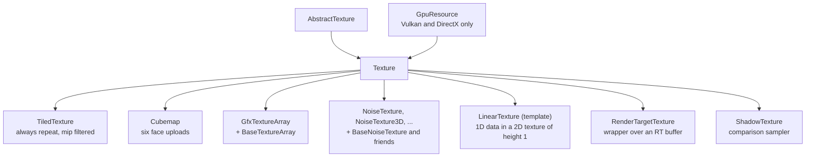

# Textures, Uploads and Samplers

Texturing is the largest surface the library exposes and the one where the three APIs differ most in
substance. The abstraction is shaped so that the *call site* is uniform and the *implementation* is
idiomatic in each backend, rather than forcing one API's model onto the others.

## The shapes

`AbstractTexture` is the interface: `Create`, `Destroy`, `IsAvailable`, `Bind`, `Release`,
`SetParams`, `Deploy`, `Load`. It is one of the few genuinely virtual interfaces in the library,
because textures *are* held through base pointers - a mesh's texture list, a draw's span, the handler's
lookup table.

Every derived shape follows the same rule: it adds **only** what is specific to it. `Cubemap` adds six
face uploads - in Vulkan and DirectX with a mip chain per face when `useMipMaps` is set.
`GfxTextureArray` adds the upload of the slots `BaseTextureArray` staged. `ShadowTexture` adds a
comparison sampler. Nothing else is duplicated.

`PrerenderedItem`, `PrerenderedText` and `PrerenderedImage` (`prerenderedtexture.h`, one shared copy
for all three backends) are not texture shapes: they own a `RenderTarget` and render into it once.
They belong to [09-components.md](09-components.md).

In Vulkan and DirectX a `Texture` is also a `GpuResource`: it registers with `GpuRegistry`, can give
up its GPU side and rebuild it from the `TextureBuffer`s it keeps. That is how a graphics device
restart brings every texture back ([10-vr-and-openxr.md](10-vr-and-openxr.md)).

`TextureBuffer` is the CPU side: the pixel data plus a `BufferInfo` describing width, height,
components, format, mip count, whether the source image had alpha and - when the file says so - its
colour encoding. A `Texture` holds a list of them - a cube map has six, an ordinary texture one; an
empty name in the file list repeats the previous buffer instead of loading it again - and
`Deploy(bufferIndex)` sends one to the GPU.

Most noise textures are computed on the CPU and saved when their file is missing. The blue noise
texture is external data: a missing file is reported to `MissingFiles` and nothing is computed.

## Create, load, deploy

The separation is deliberate and visible in every texture:

- **`Create`** makes the GPU object exist.
- **`Load`** reads files into `TextureBuffer`s. It takes a folder plus a list of file names, which is
  what makes a cube map a single `Load` call.
- **`Deploy`** uploads a buffer to the GPU.
- **`SetParams`** applies the sampling configuration.
- **`Bind` / `Release`** make it available to a draw.

`TextureCreationParams` carries the load-time options in one struct: premultiply, flip, mip maps,
color encoding (linear or sRGB), whether the texture is required, whether it is disposable, the
cartoonize switch and its parameters (blur, gradients, outline), and a key decoration for the lookup
table (Vulkan and DirectX, see below; OpenGL ignores it). A required texture that cannot be loaded is
reported to basetools' `MissingFiles`; an optional one is not.

All three backends load through one function, `LoadTextureFile` (`ddsloader.h`), so the decision
between DDS and image lives in one place:

- If the device has block compression (`GfxFeature::BlockCompression`) and a `.dds` / `.DDS` file of
  the same base name lies next to the requested one, the DDS is loaded instead - DDS is preferred, the
  image is the fallback.
- A `.dds` file is read by the DDS loader: BC1, BC4, BC5 or BC7, with the mip chain the file brings.
  Without block compression a DDS is refused, not decoded.
- Everything else goes through SDL_image.

`TextureBuffer::BufferInfo` reflects that split: the DDS path fills `m_gfxFormat` and `m_mipCount`,
while the image path leaves the RGBA8 / one-mip defaults. For block-compressed data the component
count is 0 and the data size is the total across all mip levels. When the application switches it on
(`SetUseFileColorEncoding`), the colour encoding comes from the file - an `_SRGB` DXGI format, or a PNG
with an sRGB chunk or no colour space information at all - and takes precedence over the one the caller
passed.

The loader also works from memory (`LoadTextureMemory`: a DDS or an image held in a buffer) and
decodes BC7 and BC4 blocks to RGBA8 on the CPU, a range of block rows at a time
(`DecodeCompressedRows`), so a caller can spread the work over threads; `LoadCompressedAlpha` decodes
only the alpha of a BC7 file. That is all the library knows about packed texture archives: d2x-xl reads
the DMRP `.sgv` packages itself and hands the images it finds to these functions.

`GLBLoader` (glTF/GLB, via tiny_gltf) and `ObjLoader` (Wavefront OBJ) are further input paths; they
bring geometry as well as textures and belong to [09-components.md](09-components.md). A model image
that has a DDS twin is not read from the model.

## The texture handler

`TextureHandler` exists for one reason stated plainly in its header: to release every texture at
program termination in a defined order, without a dozen places in the game having to remember.
`Texture::textureLUT` is a static AVL tree keyed by name, and `Register` puts a texture into it.

The handler is also the texture factory, and the lookup table doubles as a cache: `CreateTextures`
(and its standard, tiled, cube map and by-type variants) first looks the key up and hands out the
texture already loaded under it. The key is the file name, in Vulkan and DirectX decorated with
`TextureCreationParams::keyDecoration` (`"{}"` stands for the file name), so the same file can be
loaded a second time under a key of its own, with its own wrapping and filtering. When a required
texture of a list fails, the whole list is deleted and an empty one returned.

`Redeploy` re-uploads every registered texture. A graphics device restart in Vulkan and DirectX
(`ShutdownGraphics` / `RestartGraphics`) does not use it but goes through `GpuRegistry`: every texture
releases its GPU side before the device goes and redeploys from its kept `TextureBuffer`s, bindless
entry included, once the new device is up.

## Sampling

`TextureSampling` (see [02-api-abstraction.md](02-api-abstraction.md)) is the neutral description.
What happens to it is the deepest split in the library:

**Vulkan and DirectX** have sampler objects independent of the texture. `SamplerCache` maps a
`TextureSampling` value to a `VkSampler` / a slot in the D3D12 sampler heap through an AVL tree,
created lazily on first use and kept for the lifetime of the application. Two textures with the same
sampling share one sampler object. In Vulkan `Destroy` frees them all at shutdown, before the device
goes, and anisotropy is clamped to the device limit (off without `GfxFeature::Anisotropy`). In DirectX
the samplers live in the 2048 entry shader-visible sampler heap and go with it; the bindless texture
heap, when it exists, takes 1024 of those entries.

**OpenGL** has no sampler objects in this library at all. Filtering and wrapping are state of the
texture object, set with `glTexParameteri` while the texture is bound. `Texture::SetParams` is
therefore split in two: `DefaultSampling` fills `m_sampling` with the policy (linear, mip mapped if
asked for, the recorded wrap modes) and `ApplySampling` writes `m_sampling` into the bound GL texture.
A derived texture with a filter policy of its own fills the record differently and applies it the same
way. Vulkan and DirectX spell `SetParams` the same way, with an empty `ApplySampling`, because there
the sampler is derived from `m_sampling` on every bind.

The consequence at the call site is the one to remember:

> In OpenGL the filter is a property of the texture and outlives the bind. In Vulkan and DirectX it is
> a property of the sampler, chosen per bind.

`RenderTarget::BindBuffer(bufferIndex, tmuIndex, filterMode)` is where this becomes visible: in
OpenGL the overload has to re-apply the filter with `glTexParameteri` on *every* bind, because the
previous binder may have left a different one on the same texture object.

### The wrap mode default

Every backend's `Texture` constructor defaults to repeat on both axes, and the OpenGL header records
why: `SetParams` used to force repeat on every texture regardless of the member, so repeat is what the
default had been all along. When `SetParams` started reading the member, the default had to be changed
to say the same thing. The two wrap axes are kept separately (`m_wrapMode`, `m_wrapModeV`; Vulkan and
DirectX use the V mode for W too) and differ only where asked for. Shapes with a policy of their own
override them: a texture array is created clamped, a cube map and a render target wrapper clamp to
the edge, a shadow texture clamps to a white border, a linear texture clamps unless created
repeating, a tiled texture always repeats.

## Bindless textures

Optional, behind `GfxFeature::BindlessTextures` (optional in the default request). Vulkan offers it
when the device has the descriptor indexing features it needs, DirectX from resource binding tier 2
on, OpenGL not at all. `BindlessTextureHeap` (one per backend) then holds one long-lived table that a
shader indexes instead of a bound slot: three arrays of views - `Texture2D`, `Texture2DArray`,
`TextureCube` - and one array of samplers sharing the same index, so an entry is a view plus the
sampler of the texture's own sampling. Only those three texture types fit. The HLSL declarations live
in `include/bindless_textures.h` (`bindless2D` t0 space3, `bindless2DArray` t0 space4, `bindlessCube`
t0 space5, `bindlessSamplers` s0 space3); how a shader gets them is described in
[08-shaders.md](08-shaders.md). Capacity: Vulkan up to 16384 entries, fewer where the device limits
leave less room; DirectX 1024, because the heap's samplers share the 2048 entry sampler heap with the
sampler cache.

A texture enters the heap only when asked (`Texture::EnableBindless`); `BindlessIndex` is its index,
and `ReleaseBindless` gives the index back - not at once, but after the frames that may still read it.
The rule that follows: an entry is never rewritten while a frame may be reading it. A texture that
gets a new view or a new sampler - a redeploy, an update of a `LinearTexture`, `SetWrapping` -
therefore moves to a new index (`RefreshBindless`), and whoever stored the index has to fetch it
again.

## Mip chains

Vulkan and DirectX have no `glGenerateMipmap`, so wherever they want a chain it is built on the CPU
with a 2x2 box filter (2x2x2 for volumes, `texture_mips.h`) and every level is uploaded when the
texture is created. OpenGL lets the driver build it, except where the averaging has to happen in
linear space. Which textures get a chain:

- **2D textures** created with `useMipMaps`: Vulkan and DirectX build the chain in the upload
  (`UploadTextureDataWithMips`); OpenGL calls `glGenerateMipmap`, for an sRGB texture
  `GenerateSRGBMipChain`.
- **Cube maps** with `useMipMaps` (Vulkan, DirectX): one chain per face (`BuildMipChain2D`), uploaded
  like a six-layer array. Without the flag a cube map has one level.
- **Texture arrays**: `BaseTextureArray::BuildMipChains`, one chain per slot - in Vulkan and DirectX
  always, in OpenGL for sRGB arrays; a linear OpenGL array uses `glGenerateMipmap`.
- **3D textures**: only when the caller asks for it (`generateMips` of `Upload3DTexture`, built by
  `BuildMipChain3D` or `glGenerateMipmap`). Of the library's own textures only the cloud shape noise
  does; the others go up with one level.
- **Block-compressed textures** bring their chain in the DDS file; nothing is generated.
- **The texture atlas**: `TextureAtlas::BuildMipMaps` reads level 0 back and builds the rest with
  `BuildAlphaMipChain2D`, which weights the colours by alpha so the transparent texels around a glyph
  do not darken its edge.

sRGB has its own path. Averaging sRGB-encoded texels as if they were linear is wrong, so for an sRGB
texture every level is decoded to linear, averaged and re-encoded (`Downsample2D_SRGB8`, used by all of
the 8 bit paths above except the atlas; in OpenGL through `GenerateSRGBMipChain` and
`UploadSRGBMipChain`).

## Upload

Each backend has a `gfxupload.h` that forwards to its own: `oglupload`, `vkupload`, `dx12upload`.

**OpenGL** uploads with `glTexImage2D` / `glTexSubImage2D` / `glCompressedTexImage2D` and friends -
the data is copied by the driver and the call returns.

**Vulkan and DirectX** need a staging buffer in host-visible memory, a copy recorded into a command
buffer and a layout / state transition around it. Where the copy goes follows one rule for every
upload path - plain 2D, mip chains, block-compressed, arrays, cube maps, 3D:

- *Inside a frame* (a command list is recording) the copies go onto the frame's detached upload list
  (`CommandListHandler::UploadCmdBuffer` / `UploadCmdList`). It is registered when it is opened, so it
  runs ahead of every list closed after that, and all of a frame's uploads reach the GPU as one batch
  in front of the draws that read them. Nothing waits for the GPU in the middle of a frame; the
  staging buffers go back through the deferred release. DirectX records into an ordered copy list of
  its own instead while the draw buffers are suspended.
- *Outside a frame* (setup, a level load) the upload is a one-shot submission that is waited for
  before the call returns - `BeginSingleTimeCommands` / `EndSingleTimeCommands` in Vulkan, a temporary
  list in DirectX.

`vkupload` also provides `CreateStagingBuffer` (host write, `SEQUENTIAL_WRITE`) and
`CreateReadbackBuffer` (host read, transfer destination) - two calls rather than one, because reading
from a write-combined staging buffer is a mistake on some memory types - and `UploadSubresource`, the
low-level entry that records into an *already open* command buffer.

`ImageLayoutTracker` (Vulkan) records the current layout of each image so the transitions can be
generated without the caller tracking state. DirectX keeps a state per render target buffer,
`GfxArray` and back buffer; a plain texture is created in `COPY_DEST`, the upload ends in the shader
read state, and a re-upload says so (`isRefresh`).

For `UploadSubresource` the staging buffer's lifetime is the caller's problem, and the header says so:
it must stay alive until the command buffer has been submitted and waited on.

## Atlases and arrays

Both put many images behind one binding, which is what saves the batch. The library uses both and the
choice between them is documented in `base_texturearray.h` as a rule:

| | Texture array | Texture atlas |
| --- | --- | --- |
| layout | one slot per image, all the same size | images side by side in one image |
| borders | each slot has its own | only the padding the atlas is created with |
| mip maps | possible - a level never mixes slots | only as many levels as the padding covers |
| filtering | possible | a bilinear tap at a cell edge reads the neighbour unless the cell is padded |
| use for | sprite sheets, anything filtered or minified | unfiltered, unminified cells; padded glyphs |

`VariableTextureAtlas` is always created with nearest filtering and no mip maps. `TextureAtlas`
defaults to the same, but its creator can choose the filter, a padding around every cell and a number
of mip levels. With mip levels the padding is widened to 2^(levels-1) texels of the scaled target, so
a tap into the smallest level stays inside the cell's own margin; the owner calls `BuildMipMaps` after
the last `Add`. The font handler's letter atlas is linear filtered with one texel of padding. Mip
levels exist in Vulkan and DirectX only; OpenGL's render target has one level, so there the atlas has
none. Sprite sheets are arrays.

`BaseTextureArray` owns the slot geometry and one flat CPU buffer - slot after slot, rows within a
slot - because that is exactly the layout every backend's 3D upload call wants, so the whole array
goes up in one call with no packing step. Every slot has the same size, and an undersized image is
scaled up into its slot with a bilinear resample (not a box filter: these are sprites being magnified,
and bilinear is what magnification wants). The scaling happens once, when the array is filled. Slots
can also hold block-compressed data (`CreateCompressedSlots`, `SetCompressedSlot`): every slot then
carries the mip chain of its DDS, which must match the array's size, format and mip count exactly -
nothing is scaled.

`BaseTextureAtlas` is the shared half of the atlases: a render target holding the image store, plus
the operations on it. `TextureAtlas` puts a fixed grid on top, `VariableTextureAtlas` a skyline packer
(`SkylinePacker`) for tiles of differing size. Neither knows about the other's layout.

An atlas normally owns its render target, but it may instead *be one array layer* of a target somebody
else owns - which is how many pages of the same atlas live in a single texture and a shader reaches a
page through a layer index rather than through a texture binding. The owner is then responsible for
the target's life.

## Render targets as textures

`RenderTargetTexture` is a `Texture` wrapping one color buffer of a `RenderTarget`, and `ShadowTexture`
is the depth equivalent with a comparison sampler for hardware PCF. They are thin by design, and the
one subtlety - one wrapper per color buffer rather than one per target - is described in
[05-render-targets-and-draw-buffers.md](05-render-targets-and-draw-buffers.md).

A colour buffer can have mip levels (`RTCreationParams::mipLevels`, Vulkan and DirectX, not for array
or multiview targets): rendering goes into level 0, the texture handed out for sampling covers all
levels, and the owner writes the levels below - as `TextureAtlas::BuildMipMaps` does. OpenGL takes the
parameter and creates one level.

`LinearTexture` is the other direction: a one-dimensional array of values (bytes or `Vector4f`)
written from the CPU, stored as a 2D texture of height 1 and sampled nearest. Every update creates a
new image (Vulkan) or resource (DirectX); in Vulkan the old one goes through `GfxResourceHandler`'s
deferred release, because frames in flight may still read it.

## Divergences

- `USE_SHARED_POINTERS` is `#undef`'d and defined to 0 in every backend's `texturebuffer.h` and in the
  OpenGL `texture.h`, while `USE_SHARED_HANDLES` is forced to 1 there and in the OpenGL
  `gfxdatabuffer.h` / `gfxdatalayout.h` - so the shared-pointer branches and the raw-handle branches
  are both unreachable.
- The OpenGL `Texture` stores its type and wrap mode as raw `GLenum` / `int` rather than as
  `TextureType` / `GfxWrapMode`, and converts at the boundary (`GLWrapMode`, `WrapModeFromGL`). The
  other two store the neutral enums.
- `texturehandler.cpp` exists once per backend although `texturehandler.h` is shared; the Vulkan and
  DirectX copies are identical, the OpenGL one differs only in ignoring the key decoration.
- `TextureCreationParams::isDisposable` is stored (`m_isDisposable`) by every backend and read nowhere;
  the Vulkan deferred release that used to depend on it no longer does.
- Several header comments contradict the code: `texture_mips.h` (every 3D texture with a full
  pyramid), `base_texturearray.h` (every atlas nearest and without mips), `textureatlas.h` (a shelf
  packer), `ddsloader.h` (BC1 and BC7 only; backends passing `allowDDS = false` - all pass true).
- `vulkan/include` and `vulkan/src` still hold `dx12context.h`, `dx12framework.h`, `dx12upload.h` and
  `dx12context.cpp`, which neither the Vulkan project file nor its Makefile references.
