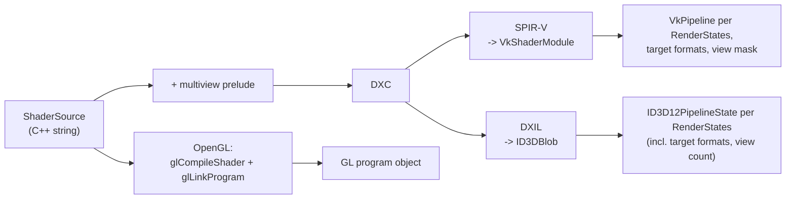

# Shaders

A shader crosses every boundary in the library: its source is text in a language the backend
dictates, its parameters are set through one API-neutral interface, and its compiled form is part of
a pipeline that only two of the three backends have. This document describes how those are separated.

## Shader sources live in C++

There are no `.glsl` or `.hlsl` files. A shader source is a `ShaderSource` object built from raw
string literals inside a `.cpp` file, registered under a name:

```
const ShaderSource& ToneMapShader() {
    static const ShaderSource toneMapShader("tonemap", Offset2DVS(), String(R"( ... )"), ...);
    return toneMapShader;
}
```

`ShaderSourceParams` names the stages - `vs`, `fs`, `gs`, `tcs`/`tes` (both or neither), or `cs` for a
compute shader - plus compiler macros, the expected vertex `dataLayout` and a minimum feature level.
Sharing a stage between shaders is then just calling the function that returns it, as the tone mapper
does with `Offset2DVS()`. The compiler macros become `#define` lines in front of every stage; the
minimum feature level is evaluated by the OpenGL backend only.

`BaseShaderCode` holds the registry. Its constructor lists the library's `ShaderSource`s as pending;
`BaseShaderHandler::CreateShaders()` loads the stored pipeline caches and then builds every pending
source into a `Shader` or `ComputeShader`, kept in a dictionary from shader id to the created object.
The source list is consumed in the process. An application derives from both to add its own shaders -
`CreateShaderCode` is virtual for that, and `BaseShaderHandler` is a `PolymorphSingleton` like the
renderer.

Creation need not happen in one go: `CreateShaders(ids)` builds only the named sources, and
`PendingShaderCount` / `CreateNextShader` build the rest one at a time, so an application can show
progress meanwhile.

### Two source sets, not three

| Backend | Source files | Language |
| --- | --- | --- |
| OpenGL | `opengl/src/*_shader(s).cpp`, `base_shader_funcs.cpp`, `base_texture_shaders.cpp` (10 files) | GLSL |
| Vulkan | `src/common-hlsl/*.cpp` (13 files) | HLSL |
| DirectX | `src/common-hlsl/*.cpp` (the same 13 files) | HLSL |

Vulkan and DirectX share one set of HLSL sources, compiled to SPIR-V and DXIL respectively by the same
compiler (DXC). That is the reason the shared set exists: two backends, one source of truth, no
opportunity for them to drift apart in behaviour.

The file names are identical in both trees (`tonemap_shader.cpp` exists in `opengl/src` and in
`src/common-hlsl`), and each project file references only its own. Three of the HLSL files - the
Kuwahara filter, the FFT ocean and the OpenXR shaders - have no GLSL counterpart.

### The HLSL to GLSL bridge

For *snippets* shared with OpenGL there is a third arrangement: the snippet is written in HLSL as the
single source of truth, and an OpenGL shader puts the bridge in front of its final source so the same
body compiles as GLSL. `hlslbridge.inl` provides it as a function, `HLSLBridge(glslVersion)`, compiled
in the OpenGL build only: the `#version` line from `GLSLVersion()` followed by a block of `#define`s -
`float2` to `vec2`, `lerp` to `mix`, sampling wrappers and so on. The library's own GLSL sources are
written in GLSL and do not use it; its users are application shaders (Paintjob Rampage's OpenGL cloud
and wormhole shaders).

The convention stated in the header is to include the whole bridge rather than individual defines:
unused defines cost nothing and one central mapping keeps the per-shader headers small.

HLSL backends never include the bridge - for them the syntax is native.

## Setting parameters

The public interface is the same in all three backends: `SetFloat`, `SetInt`, `SetVector2f`,
`SetMatrix4f`, `SetMatrix4fArray`, `UpdateMatrices` and their relatives, all addressing a parameter
**by name**. What happens behind them is completely different.

**OpenGL**: a name is a uniform location, looked up with `glGetUniformLocation`. A per-shader cache of
locations and values (`GetUniform`) exists behind `CACHE_SHADER_DATA`, which is 0 in debug and release
builds, so a named uniform is looked up on every set. Only the four base matrices keep their location
(below).

**Vulkan and DirectX**: there are no named uniforms. A parameter is a field at a byte offset inside a
constant buffer, and the offsets come from reflecting the compiled bytecode on link.
`SetB1Field(name, data, size)` looks up the offset in a per-shader cache and writes into the CPU-side
staging buffer of every stage that declares the field, marking a stage for upload only when the value
actually changed; a miss scans the reflected per-stage field tables once and caches the result.

### The four base matrices

Model-view, projection, viewport and light transform are addressed by **enum** rather than by name:

```
enum eBaseMatrices { bmModelView, bmProjection, bmViewport, bmLightTransform, bmCount };
Shader::SetMatrix4f (eBaseMatrices, const float*, bool transpose);
```

They are the base inventory every shader has, and giving them a fixed identity removes them from the
name lookup entirely. In Vulkan and DirectX they live in `FrameConstants`, the `b0` constant buffer,
and `TrySetB0Field` maps the enum to its slot with a `switch`. The four matrices fill its first 256
bytes; behind them come the per-eye projections, views and their inverses for multiview rendering,
640 bytes in all, and a draw with one view uploads only the first 256
([10-vr-and-openxr.md](10-vr-and-openxr.md)). In OpenGL they get their own location cache,
`m_baseLocations[bmCount]`, with a sentinel for "not looked up yet".

This is the one place where a call site must use the enum: in Vulkan and DirectX the string form goes
only to `SetB1Field`, so setting one of the four by name fails - in a debug build with one "unknown
uniform" line per name, in a release build silently - and the matrix is never set. The compiler
cannot catch it.

### The Vulkan descriptor set layout

The same bindings for every graphics shader, which is what lets the bind table
([04-command-lists.md](04-command-lists.md)) stage bindings without knowing the shader. Each shader
builds its set layout from them (only binding 66 depends on the shader), and the descriptor set
written for a draw fills only the slots the shader's reflection says it declares:

| Binding | Type | Stage | Register |
| --- | --- | --- | --- |
| 0 | uniform buffer, dynamic | all graphics | b0 - FrameConstants |
| 1-3 | uniform buffer, dynamic | VS / PS / GS | b1 per stage |
| 4-19 | sampled image | all graphics | t0-t15 |
| 20-35 | sampler | all graphics | s0-s15, paired 1:1 with the t-slots |
| 36-39 | storage buffer | all graphics | u0-u3 |
| 40-41 | uniform buffer, dynamic | tessellation control / evaluation | b1 per stage |
| 42-65 | storage buffer (read-only) | all graphics | t0-t23, space1 |
| 66 | acceleration structure | all graphics | t0, space2 - only in a shader that declares one |
| 67-74 | sampled image | all graphics | t16-t23 |
| 75-82 | sampler | all graphics | s16-s23, paired 1:1 with the t-slots |

There are 24 texture and sampler slots. The eight above t15 / s15 are appended behind the acceleration
structure instead of renumbering, so every binding number that existed before stayed what it was;
`Shader::SrvBinding` and `SamplerBinding` translate a slot into its binding. The mapping is passed to
DXC register by register (`-fvk-bind-register`) and has to agree with this table.

The `b1` buffers being *dynamic* uniform buffers is what makes per-draw constants cheap: the
descriptor set stays the same and only an offset changes.

A shader that reads the bindless texture heap ([07-textures-and-samplers.md](07-textures-and-samplers.md))
uses a second set: set 1, with the heap's arrays at bindings 0-3 (t0 space3/4/5, s0 space3). Its
register mapping is passed to DXC only for sources that name one of those spaces, and the pipeline
layout gets set 1 only when the reflection finds it used, so every other shader compiles and caches
as before. A shader that reads the heap on a device without one is not created. DirectX gives such a
shader four unbounded descriptor tables in its root signature instead.

### Constant buffer allocation

`CbvLinearAllocator` is the per-frame linear allocator behind that. Each frame slot owns one
persistent-mapped host-visible uniform buffer; `Allocate(size)` returns a `{cpu pointer, dynamic
offset, buffer}` triple, the caller memcpy's its constants in, and the offset goes into
`vkCmdBindDescriptorSets`. `Reset(frameIndex)` rewinds the cursor at frame start.

A frame that exceeds its slot's buffer chains further buffers on the spot rather than failing, and if
the previous frame overshot, the slot's own buffer is reallocated up to a ceiling. So an allocation
fails only when the device is out of memory - which is what lets a caller treat it as infallible.

The allocator counts its resets (`Generation`), and a shader in Vulkan or DirectX uploads `b0` and each
`b1` stage only when its constants changed or the generation is new; otherwise the draw reuses the
previous allocation.

Descriptor sets follow the same never-fail rule: `DescriptorPoolHandler` keeps one pool per frame
slot, reset when the slot comes round again, and creates further pools on the spot when a frame needs
more than the 1024 sets a pool is budgeted for.

## Binding a shader for a draw

`BaseShaderHandler::SetupRenderShader(shaderId, depthShaderId)` selects and activates a shader. During
a shadow pass the depth shader (by default `surfaceShadowShader`) takes the place of the requested
one. The handler tracks which shader is active (`m_activeShader`, `m_activeShaderId`): a repeated
setup of the same id skips the lookup, and in OpenGL also the activation, because a GL program binding
persists. In Vulkan and DirectX `Activate` runs on every setup - it resolves the pipeline for the
current render states and target formats (`ResolveDrawPipeline`, which returns at once when command
list, shader, render states and target formats are those of the previous call). Every setup copies
the base matrices into the shader (`UpdateMatrices`).

A shader id that does not exist or did not compile is logged once per id, as soon as no shader
creation is pending any more (`ReportUnavailableShader`).

`InvalidateActiveShader` resets that tracking. Vulkan and DirectX call it at `BeginFrame`, and the
handler's recompile and destroy calls call it, so the tracking never refers to a shader of a previous
frame or to one that has just been rebuilt.

`Shader::UpdateVariables` (Vulkan and DirectX; OpenGL needs none, its uniforms took effect when they
were set) runs right before each draw and is where the staged state becomes real. It uploads `b0` and
the `b1` stages that changed, then:

- in Vulkan it collects what the draw binds - uniform buffers, image views, samplers, storage
  buffers, the acceleration structure - and binds the shader's previous descriptor set again when all
  of that is unchanged and neither the descriptor pool nor a resource release has moved on since;
  otherwise it allocates a set, writes it and binds it with the dynamic offsets. Only declared slots
  are written: a declared texture slot nobody bound gets a 1x1 default image of the declared view
  type, a declared read-only buffer slot a 256 byte default buffer.
- in DirectX it builds and sets the descriptor tables and root arguments that changed; an unbound
  texture slot gets a default view of the declared type, an unbound buffer slot a null view.

A shader that declares an acceleration structure refuses the draw, with a log line, when none is
bound. The reuse paths sit behind `OPTIMIZE_SHADER_LOADING` in each backend's `shader_loading.h`.

## From source to pipeline



Both HLSL backends compile with DXC (`IDxcCompiler3` / `IDxcUtils`). In Vulkan the wrapper is
`ShaderCompiler`, which adds `-spirv`, the SPIR-V target environment of the device (Vulkan 1.2 or 1.3)
and `-fvk-use-dx-layout`; DirectX calls DXC from its `Shader` and `ComputeShader` directly. The
optimization level follows the build: `-Od` in debug, `-O3` otherwise. In Vulkan the caller passes one
`-fvk-bind-register` per register (`b1` gets one binding per stage); the list has to agree with the
descriptor set layout above.

Every HLSL source is compiled with the multiview prelude in front (see "View count" below). The
profile is 6_0, 6_1 with two views. A source that declares a `RaytracingAccelerationStructure` is
compiled for 6_5, is only created on a device with ray tracing, and binds the structure at t0 space2 -
binding 66 in Vulkan, a root SRV in DirectX. In Vulkan the SPIR-V of such a shader is post-processed
before it is cached: when a ray query uses the triangle or AABB culling flags and the module does not
declare the primitive culling capability, the capability is added. The version of that step
(`kSpirvPatchVersion`) is part of every cache key, so a change to it recompiles all shaders.

A compile failure logs one line with the shader's name and the first error line of the compiler output
(`ShaderErrorSummary`) in every build; the full compiler output only in debug builds.

In OpenGL a program object *is* the compiled shader and there is nothing more to build. In Vulkan and
DirectX the compiled bytecode is only one half of a pipeline; the other half is the `RenderStates`
block, and the pipeline is created per combination - which is the mechanism described in
[02-api-abstraction.md](02-api-abstraction.md).

## The caches

Three separate caches, at three levels:

- **`ShaderCache`** (shared, `include/shadercache.h`) is a small on-disk blob store and the only reader
  and writer of the cache files: compiled shaders (`.spv` / `.dxil`), the pipeline stores and the
  pipeline key records. A file is a header with magic number, tag, key and size, then the bytes; the
  key is an FNV-1a hash of whatever identifies the content - for a shader the source with its prelude,
  every compiler argument and the DXC version. It is what keeps DXC from recompiling unchanged HLSL on
  every start. The application sets the folder once (`SetFolder`); `GetFolder` returns that folder for
  one view and its subfolder `vr` for two, so the monitor and the multiview path keep separate files
  and a VR switch never overwrites the other path's cache.
- **The pipeline / PSO cache** lives in memory. `PipelineCache` in Vulkan keys a pipeline on
  `{shader, RenderStates, colour and depth formats, view mask}`, `PSO::GetPSO` in DirectX on
  `{shader, RenderStates}`, where the DirectX `RenderStates` carry the target formats and the view
  count themselves. In Vulkan, when the device has graphics pipeline libraries, a shader's vertex
  input, pre-rasterization and fragment parts are built as libraries when the shader is created, and a
  draw's pipeline is linked from them.
- **The on-disk pipeline store**: `VkPipelineCache` in Vulkan, `ID3D12PipelineLibrary` in DirectX, one
  per mode (one view, two views), both loaded by `BaseRenderer::LoadPipelineCache` when the shaders are
  first created and written by `SavePipelineCache` - each into its own folder, and only when it was
  used or changed.

`PrecreatePipelines` closes the loop: both backends record the pipelines they needed, per mode
(`pipelinekeys.vulkan` / `pipelinekeys.d3d12`: shader name, render states, target formats, view mask or
count), so a later run can build those pipelines up front instead of during play - with an optional
progress callback per record - and the stores are saved right after the precreation when they hold
something new, not only at a clean exit. The one-view records drop entries for more views when they
are loaded. Lazy pipeline creation in the middle of a frame is a visible stutter, and this is the
answer to it.

## View count

Every HLSL source is compiled for the renderer's current view count: `MultiviewHlslPrelude`
(`multiview_hlsl.h`) is put in front of it and defines `VIEW_COUNT`, the view id input, screen
textures as arrays and the per-eye projection for two views, and plain fallbacks for one. A change of
the view count therefore needs every shader compiled again. `Shader` and `ComputeShader` keep their
sources for that and rebuild in place (`Recreate`), so the objects call sites hold stay valid. The
handler offers `RecreateShaders`, `RecreateShader` by index or id together with `ShaderCount` (for a
recompile in steps under a progress display) and `DestroyShaders`. In OpenGL these calls do nothing.
The VR side of it is described in [10-vr-and-openxr.md](10-vr-and-openxr.md).

## Compute shaders

`ComputeShader` is a separate class in each backend. A compute `ShaderSource` carries `cs` instead of
the graphics stages plus an explicit `computeBindings` array of `ComputeBindingDesc` entries (binding
index, kind, count) - because a compute pipeline's descriptor layout is not the fixed graphics one
above and has to be described. The kinds are uniform buffer, sampled image, storage image, storage
buffer, sampler, combined image sampler and read-only buffer, the last being the `t0..t23 space1`
structured buffers of the graphics shaders. In Vulkan the registers map to the same binding numbers
as in a graphics shader (only `b1` has a single binding), so an HLSL snippet reads the same bindings
in both. The target profile is `cs_6_0`, `cs_6_5` for a source that declares an acceleration
structure.

Buffers come from what the caller bound through `GfxArray` - the bind table the graphics path reads;
render target buffers are bound per dispatch as sampled or storage images (`BindSampledImage`,
`BindStorageImage`). `Dispatch` records into the frame's command list (Vulkan suspends the rendering
scope around it); `DispatchOnce` runs one pass in a submission of its own and waits, for work outside
the drawing of a frame such as precomputations at a level load.

`BaseShaderHandler::SetupComputeShader(shaderId)` is the entry point.

## Ready-made shaders in the library

The library brings its own shader inventory, registered under fixed ids in each backend's
`base_shadercode.cpp`:

- primitives: `lineShader`, `ringShader` (dashes optionally with round caps), `circleShader`,
  `circleMaskShader`, `rectangleShader`, `shadedRectangleShader`, `shadedRingShader`, `plainColor`,
  `colorMesh`;
- textures: `plainTexture`, `coloredTexture` (texture times vertex colour, for multi-coloured text),
  `movingTexture`, `blurTexture`, `grayScale`, `tintAndBlur`, and in Vulkan and DirectX `glyph` and
  `plainScreenTexture`;
- shadow and depth: `surfaceShadowShader`, `sphereShadowShader`, `depthRenderer`, `stencilShader`;
- post processing: `outline`, `boxblur`, `gaussblur`, `fxaa`, `bilateralBlur`, `bilateralBlurDepth`,
  `tonemap` (on a sub-rectangle of its source through `tcOffset` / `tcScale`, with an optional
  `gamma`), and in Vulkan and DirectX `bevel`;
- components: `lineDraw`, `lightningDraw`, `lightningFlare`, `skybox`, `blackhole`;
- Vulkan and DirectX only: the Kuwahara filter (ten `kuwahara*` shaders), the FFT ocean (`oceanInit`,
  `oceanSpectrum`, `oceanTransform`, `oceanAssemble` - compute shaders) and the OpenXR layer, mirror,
  depth, mask and background shaders (`xr*`).

`BaseShaderHandler` has loader methods for the ones a call site parameterizes directly -
`LoadLineShader`, `LoadRingShader`, `LoadCircleShader`, the rectangle and shaded ring shaders,
`LoadPlainTextureShader`, `LoadColoredTextureShader`, `LoadBlurTextureShader`, `LoadGrayscaleShader`;
the others are set up by the components that use them, described in
[09-components.md](09-components.md).

`GaussBlurParams` and the precomputed Gauss kernels (`ComputeGaussKernels`, `GetKernel(radius)`) sit
on the handler for the same reason: every blur in either application wants the same kernels, and
computing them once at startup is cheaper than per use.

## Divergences

- `vulkan/include/shader_compiler.h` still describes the descriptor layout work as "Phase B step 7c"
  future work and tells callers to pass `-fvk-*-shift` arguments, although the layout exists and the
  shaders pass `-fvk-bind-register` per register.
- The Vulkan `Shader` keeps the SPIR-V blobs alive after module creation "for reload / debug"; nothing
  reads them after `Create`. (The HLSL sources are needed: `Recreate` rebuilds from them.)
- The OpenGL tree and the shared HLSL tree hold ten files of identical names
  (`base_shader_funcs.cpp`, `base_texture_shaders.cpp`, `blackhole_shader.cpp`, `blur_shader.cpp`,
  `lightning_shader.cpp`, `line_shader.cpp`, `outline_shader.cpp`, `primitive_shaders.cpp`,
  `skybox_shader.cpp`, `tonemap_shader.cpp`). Nothing enforces that the GLSL and the HLSL version of
  a shader behave the same; the pair has to be kept in step by hand. `src/common-hlsl` additionally
  holds `kuwahara_shader.cpp`, `ocean_shader.cpp` and `xr_shaders.cpp`, which have no GLSL
  counterpart.
- `BaseShaderHandler`'s constructor has a disabled (`#if 0`) load of a gray noise texture whose member
  `m_grayNoise` is still declared.
- Both HLSL backends keep the earlier per-draw code compiled under `OPTIMIZE_SHADER_LOADING 0` and
  `OPTIMIZE_BUFFER_REUSE 0` (`shader_loading.h`); both switches are 1.
- Header comments behind the code: `vulkan/include/shader.h` lists the texture and sampler bindings as
  fragment-only and the layout as 24 bindings, the Vulkan `compute_shader.cpp` speaks of a 40 binding
  layout and `cs_6_0` only, `ShaderSourceParams` of `cs_6_0` only.
- In OpenGL, `RecreateShaders`, `RecreateShader` and `DestroyShaders` are empty, and the backend
  registers fewer shaders than Vulkan and DirectX (no `glyph`, `plainScreenTexture`, `bevel`,
  Kuwahara, ocean or OpenXR shaders).
