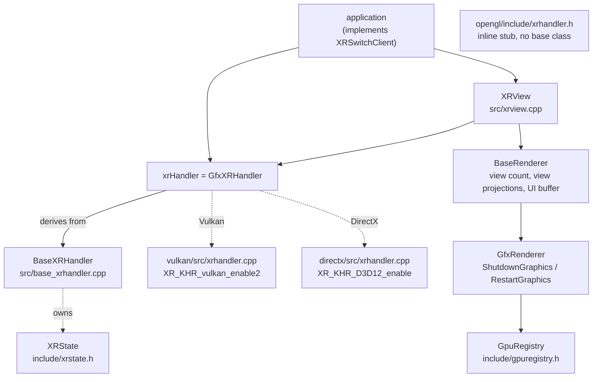
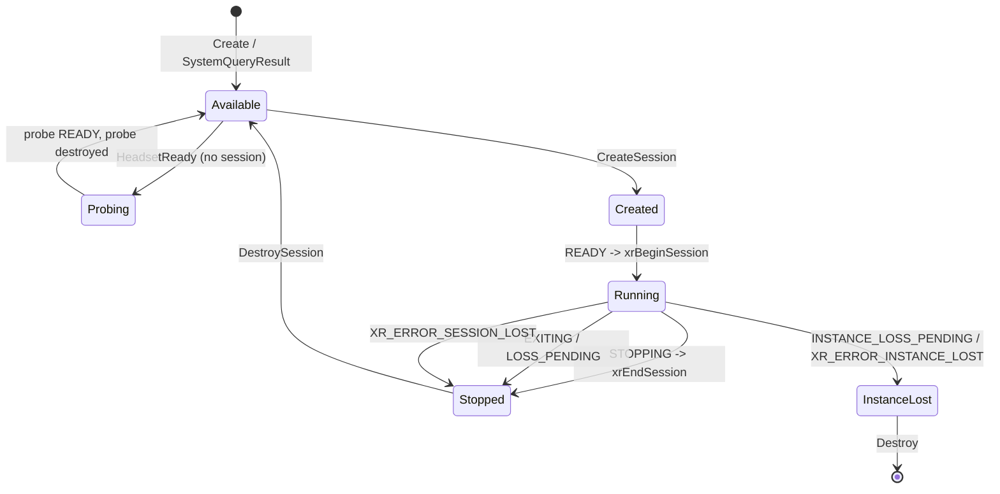
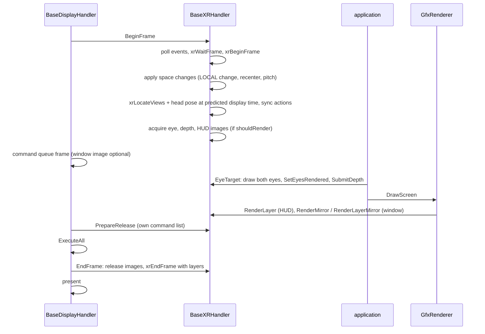
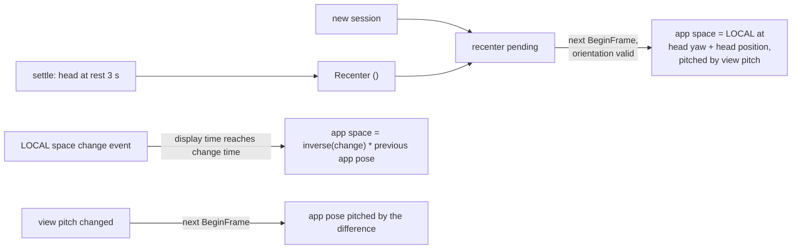
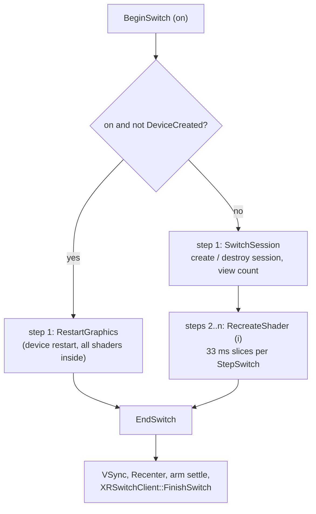
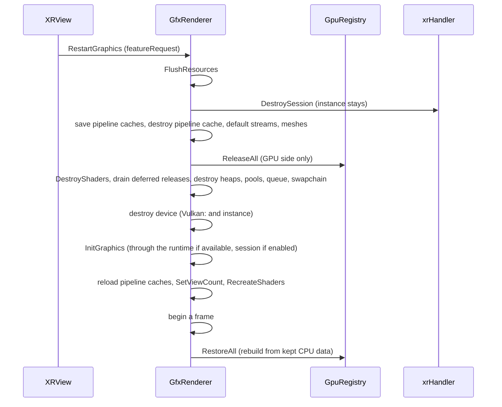

# VR and OpenXR

`rendertools` can render to a head mounted display through OpenXR. VR is not a fourth backend: the
Vulkan and DirectX builds talk to an OpenXR runtime next to their graphics API, and the OpenGL build
carries a stub that always reports "no headset". This document describes how the OpenXR code is cut
between shared and backend code, how instance, system, session and graphics device come about, how
one frame reaches both eyes and how the HUD gets into the headset, and how the library switches
between monitor and headset at runtime - under Vulkan, if need be, by taking the whole graphics
device down and building it again.

The applications use VR at two different levels. Paintjob Rampage goes through `XRView`, the
application-facing component in the shared code. D2X-XL does not use `XRView`; it calls the handler
(`xrHandler`) directly and has switch logic of its own.

## The pieces

| File | Role |
| --- | --- |
| `include/base_xrhandler.h`, `src/base_xrhandler.cpp` | API-neutral OpenXR core: instance, system query, session, spaces, frame loop, swapchains, composition layers, window mirror, recentering, controllers |
| `include/xrstate.h` | `XRState` and `XRSwapchain` - the only shared header that includes `<openxr/openxr.h>` |
| `vulkan/` and `directx/` `xrhandler.h` / `.cpp` | `GfxXRHandler`: graphics hooks and device creation through the runtime |
| `opengl/include/xrhandler.h` | `GfxXRHandler` as an inline stub |
| `include/xrview.h`, `src/xrview.cpp` | `XRView` and the `XRSwitchClient` interface |
| `include/multiview_hlsl.h` | the HLSL prelude for one or two views |
| `src/common-hlsl/xr_shaders.cpp` | layer copy, layer mirror, HUD into the eyes, eye mirror, depth copy, visibility mask, background |
| `include/gpuregistry.h` | `GpuResource` / `GpuRegistry`, for the graphics device restart |
| `include/shadercache.h`, `src/shadercache.cpp` | the shader cache folder, which depends on the view count |

### BaseXRHandler and GfxXRHandler

`BaseXRHandler` holds all OpenXR logic that does not depend on the graphics API. `GfxXRHandler` in
each backend derives from it and supplies six hooks: the name of the graphics extension,
`LoadGraphics` (backend entry points and the runtime's requirements), the session's graphics
binding, the swapchain formats in order of preference, the wrapping of swapchain images as render
targets, and whether the window's back buffer is sRGB. The backend class adds the calls its device
creation needs (`CreateVulkanInstance`, `GetVulkanPhysicalDevice`, `CreateVulkanDevice` in Vulkan,
`GetD3D12Adapter`, `CreateD3D12Device` in DirectX). `xrHandler` is the backend's singleton, the same
pattern as `baseRenderer`.

All OpenXR state lives in `XRState`. Only `xrstate.h` includes the OpenXR header; `base_xrhandler.h`
forward-declares the struct and holds a pointer to it, so code that includes the handler - every
application - never sees an OpenXR type.

`BaseXRHandler::Destroy` deletes the state. The few values that have to outlive a `Destroy` /
`Create` cycle are file statics in `base_xrhandler.cpp` instead of members of `XRState`: whether
sessions are enabled, whether the graphics device was created for the runtime (`DeviceCreated`),
whether the runtime is missing, the test pattern switch, the view pitch, the requested layer size,
the settle-recenter state and the performance metrics switch.

### The OpenGL stub

The OpenGL `GfxXRHandler` is not derived from `BaseXRHandler`. It is a standalone class of inline
functions with the same names: `Create` returns `false`, every query reports nothing there. OpenGL
has no device restart and no shader recompile - `ShutdownGraphics` is empty, `RestartGraphics`
returns `false`, and the `BaseShaderCode` recreate and destroy calls do nothing. The stub has fallen
behind the shared code; see Divergences.

## Instance, system and graphics device

**Instance.** OpenXR 1.0 with the backend's graphics extension; without that extension no instance
is created. Optional extensions are enabled where the runtime has them: composition layer depth,
visibility mask and the cylinder composition layer, plus the Meta performance metrics in builds with
`LOG_FRAME_METRICS` only. When enumerating the extensions fails with `XR_ERROR_RUNTIME_UNAVAILABLE`,
the handler records that as `RuntimeMissing`; every later instance creation replaces the value.

**System.** Head mounted display form factor. `SetupSystem` continues only if the primary stereo
view configuration reports exactly `kMaxRenderViews` (2) views, otherwise it destroys everything
again. It stores the configuration views, takes the opaque environment blend mode if the runtime
offers it (the first one otherwise), loads the visibility mask function and calls the backend's
`LoadGraphics`. The recommended eye size is the larger of the two views in each dimension; before a
session exists it serves as eye size, once one exists the size of the eye swapchain does.

**Vulkan device.** The runtime creates it. `VKContext` asks `xrHandler.IsAvailable()` at each step
of its creation: with a system available the instance comes from `xrCreateVulkanInstanceKHR`, the
physical device selection is restricted to the one the runtime names, and the logical device comes
from `xrCreateVulkanDeviceKHR`. Only that last call sets `DeviceCreated`. The session's binding
names instance, physical device, device, graphics queue family and queue 0.

**DirectX device.** `LoadGraphics` reads the adapter LUID and the minimum feature level from the
runtime. An existing device is taken over - `DeviceCreated` is set without creating anything - when
it is on that adapter, reaches that feature level and has view instancing. Otherwise the next device
creation finds the adapter by LUID, raises the feature level to the runtime's minimum and creates
the device there. The binding is device and command queue.

**Multiview is a precondition.** The feature `Multiview` means multiview including geometry and
tessellation shaders in Vulkan, view instancing tier 1 and shader model 6.1 in DirectX. It is an
optional part of the default `GfxFeatureRequest`. Without it `InitGraphics` creates no session
("VR is off") and `XRView` does not poll for a headset.

## Headset detection

| Call | Thread | What it does |
| --- | --- | --- |
| `Create` | caller | instance plus system query, synchronous; on success `SetupSystem` |
| `StartSystemQuery` / `SystemQueryResult` | worker / caller | the same work in a worker thread, the result taken by polling |
| `RuntimeMissing` | any | the last instance creation found no runtime |
| `HeadsetReady` | caller | probe session, see below |
| `SystemAvailable` | caller | synchronous `xrGetSystem` on the existing instance |

Creating an instance and asking for the system can take long when no headset is connected; polling
for one must not do that on the main thread. There is one static query object. `StartSystemQuery`
starts the thread unless a query is running; `SystemQueryResult` returns none, pending, available or
unavailable and joins the thread once it is done; `Create` and `Destroy` join it first.

- **Without a system** the query works on a pending `XRState` of its own and creates the instance
  only if that state has none, so an instance without a system stays parked there for the next
  query (a failed synchronous `Create` parks its state the same way). When `xrGetSystem` reports
  `XR_ERROR_INSTANCE_LOST`, the worker destroys that instance.
- **With a system set up already** the query is a check only: `xrGetSystem` on the existing instance
  and a comparison of the system id.

When the result is available, the pending state becomes the handler's state and `SetupSystem` runs
on the calling thread.

A system that is available does not mean the headset is in use. `HeadsetReady` tells the two apart:
only while no real session exists and only when `DeviceCreated` is set, it creates a probe session
without swapchains, polls the event queue, and returns `true` once the runtime moves the probe to
`READY`; the probe is destroyed then. Creating a real session destroys a probe as well, and the frame
loop's event handling ignores state changes of every session but the real one.

## Session lifecycle

`EnableSession` is a global switch; `InitGraphics` creates a session only when the system is
available, sessions are enabled and the device has `Multiview`.

`CreateSession` destroys a probe, resets the stopped and exited flags, marks a recenter as pending,
drops a pending reference space change, creates the session with the backend's binding, the LOCAL,
VIEW and app reference spaces (the app space starts at the identity pose), the eye, depth and HUD
swapchains and the controller actions, and reads the visibility masks. `DestroySession` takes all of
it down again, ending the session first if it is running.

**Session end and instance loss are separate states.** `STOPPING`, `EXITING`, `LOSS_PENDING` and
`XR_ERROR_SESSION_LOST` only stop the session (`SessionStopped`, and for `EXITING` also
`SessionExited`); the instance stays, and so does a device created through it, so the next session
can be created on the same device. Only the instance loss event and the `XR_ERROR_INSTANCE_LOST`
result set `InstanceLost`. A lost instance is destroyed by whoever polls next; `Destroy` resets
`DeviceCreated`, so the next switch to VR rebuilds the graphics device through the new instance.

`WaitUntilRunning` polls the session events until the session runs, stops or loses its instance, or
a timeout passes.

**Controllers.** One action set (thumbstick, trigger, squeeze, primary, secondary, menu, thumbstick
click) with suggested bindings for five interaction profiles (simple, Oculus Touch, Valve Index, HTC
Vive, Microsoft Motion). The actions are synced only while the session is `FOCUSED`; `Controller`
returns an empty state otherwise.

## The frame loop

The OpenXR frame is bracketed by the display handler's frame, and `xrWaitFrame` paces the loop -
VSync is turned off for VR (by `InitGraphics`, by the DirectX display handler at creation, and by
`XRView` at the end of a switch).

`BeginFrame` returns `false` without waiting while the session is not running. Views and head pose
are located in the app space at the predicted display time; field of view and orientation are taken
when the orientation is valid, the position only when the position is valid. Space updates are
applied *before* the views are located, so a frame's poses and the space it submits them in always
belong together.

`PrepareRelease` records, in a command list of its own, the transition of every acquired swapchain
image back to its attachment layout (Vulkan) or state (DirectX); with the test pattern on it fills
the eye image magenta first.

`EndFrame` releases the images and submits up to two layers, both in the app space:

- **the projection layer**, only when the eye image was acquired *and* rendered in this frame: one
  swapchain array slice per eye, the poses and fields of view located in `BeginFrame`, and - when
  `SubmitDepth` copied the scene depth into the depth swapchain - a depth info per view with the
  near and far plane passed in;
- **the HUD layer**, quad or cylinder (see [The HUD](#the-hud)).

A frame without eye images submits the HUD layer alone; that is how loading screens and menus
without a 3D scene stay visible.

While a session exists, a minimized window no longer blocks the loop: `WaitWhileMinimized` returns
at once in both backends, and in Vulkan the command queue begins its frame without a window image
when the window is minimized or has no swapchain.

## Swapchains

| Swapchain | Formats, in order of preference | Usage | Size | Layers | Created when |
| --- | --- | --- | --- | --- | --- |
| eye | RGBA8 sRGB, BGRA8 sRGB, RGBA16F, RGB10A2, RGBA8, BGRA8 | color attachment, sampled, transfer source | recommended eye size | 2 | always |
| depth | D32F, D24S8, D32FS8, D16 | depth attachment | eye size | 2 | the depth extension is present (a failure disables the depth layer) |
| HUD | the eye format | as eye | `LayerWidth` x `LayerHeight` | 1 | a layer size above zero is passed |

The format is chosen in the library's order, not in the runtime's, so an sRGB format wins whenever
the runtime offers one. Everything the library writes into these images is linear - the scene
composite, and the UI buffer after `xrLayerCopy` / `xrLayerEyes` decoded it - so the sRGB swapchain
format does the encoding on write. `xrMirror` encodes to sRGB itself when it shows an eye image in a
window whose back buffer is not an sRGB format.

Each swapchain image is wrapped as an *external* `RenderTarget`, with the swapchain's layer count as
its view count. The eye target is therefore an ordinary render target with two views, and the rest
of the library draws into it like into any other. External targets do not take part in the graphics
device restart; they are recreated with the session.

`SetLayerSize` records the HUD size the application wants; `LayerWidth` caps the width at the eye
width and `LayerHeight` keeps the requested aspect ratio. Without a request the HUD has the eye
size. While a session exists, a size change recreates the HUD swapchain after waiting for the GPU,
and is skipped while an image is acquired.

## Multiview

### The view count

`BaseRenderer::ViewCount` is 1 on the monitor and `kMaxRenderViews` (2) while a session exists.
`XRView`, `GfxRenderer::RestartGraphics` and D2X-XL's own switch code set it. The view count is a
property of everything compiled or created *after* it is set: shaders, pipelines, the size of `b0`,
the cache folder. Changing it therefore means recompiling - see
[Switching VR at runtime](#switching-vr-at-runtime).

### The shader prelude

Every HLSL graphics and compute shader in Vulkan and DirectX gets `MultiviewHlslPrelude(ViewCount())`
prepended before it is compiled. Its macros let one source serve both modes:

| Macro | One view | Two views |
| --- | --- | --- |
| `VIEW_COUNT` | 1 | 2 |
| `gViewId` | constant 0 | static, set from `SV_ViewID` by `SET_VIEW_ID` |
| `VIEW_ID_PARAM` / `SET_VIEW_ID` | empty | the `SV_ViewID` input and its assignment |
| `ScreenTexture`, `ScreenRWTexture` | `Texture2D`, `RWTexture2D` | `Texture2DArray`, `RWTexture2DArray` |
| `SCREEN_UV`, `SCREEN_TEXEL`, `SCREEN_STORE`, `SCREEN_DIMENSIONS` | 2D addressing | the view index as array slice |
| `SCREEN_LAYER(layer)` | `layer` | `layer * VIEW_COUNT + gViewId` |
| `FRAME_EYE_MATRICES` / `EYE_MATRICES` | empty | the eye projections and eye views in `b0` |
| `VIEW_PROJECTION` | `mProjection` | `mEyeProjection[gViewId]` |

With two views the graphics stages are compiled for shader model 6.1 instead of 6.0 - the model
that has `SV_ViewID`, and the reason DirectX requires it. The shared HLSL shaders use the macros
(the 2D and 3D base vertex shaders, texture and primitive shaders, lines, skybox, black hole,
lightning, blur, Kuwahara, tone mapping); the ocean and outline shaders do not.

### Pipelines

Whether a draw is multiview is decided by the **target**, not by the global view count. In Vulkan
the active render target's view count yields the rendering view mask and the view mask in the
pipeline key (the pre-rasterization and fragment shader libraries are built with the mask of the
global view count). In DirectX a target with two views leads to a view-instanced pipeline state,
built through a pipeline state stream with two view instances on render target array slices 0 and 1;
all other draws use the ordinary pipeline description.

The consequence: while VR is on, single-view targets such as the screen buffer and a UI buffer are
drawn by the same stereo-compiled shaders without a view mask.

### Render targets with two views

`RTCreationParams::viewCount` is chosen per target by the application; the library does not derive
it from the global view count.

- A target with two views allocates `layer groups x views` array layers for every attachment buffer
  (color, vertex, id, depth). Layer group *g* occupies the layers `g * views` to `g * views + views - 1`
  and is attached through an array view over its two layers - the layout `SCREEN_LAYER` addresses.
- Targets with two views have a single mip level.
- For sampling, an array buffer carries a view of its first layer next to the view over all layers.
  In two-view mode `GetAsTexture` hands out the first-layer view as the plain texture and the full
  view as the array view; Vulkan's shader reflection marks which texture slots are declared as
  arrays, and the bind picks the matching view. DirectX keeps a single-slice SRV next to the array
  SRV.
- A single-view attachment buffer created while the view count is 2 also gets a one-layer array
  view, so a shader that declares `ScreenTexture` can sample it in two-view mode.

### Per-eye matrices in `b0`

`FrameConstants` (the same in Vulkan and DirectX) has grown to 640 bytes:

| Field | Count | Bound in mono |
| --- | --- | --- |
| `mModelView`, `mProjection`, `mViewport`, `mLightTransform` | 1 each | yes (256 bytes) |
| `mEyeProjection` | `kMaxRenderViews` | no |
| `mEyeView` | `kMaxRenderViews` | no |
| `mHeadFromEye` | `kMaxRenderViews` | no |

`FrameConstantsSize(viewCount)` binds 256 bytes for one view and the whole struct for two. The
prelude's `FRAME_EYE_MATRICES` declares the eye projections and eye views; `mHeadFromEye` follows
them in `b0` but is not part of the prelude, so a shader that needs it declares it itself (D2X-XL's
shaders do, the library's own do not use it).

The eye matrices are not set per draw. They are registered with the renderer, keyed by a projection
matrix:

- `SetViewProjections` stores one set together with `headFromEye`, the general inverse of each eye
  view - general rather than a transpose, so it stays valid for eye views that are not rigid.
- Registering a projection that is stored already moves it to the end of the list; there are at
  most eight entries, the oldest is dropped beyond that.
- `Shader::UpdateMatrices` looks the **current projection** up (`FindViewProjections`) and copies
  the eye matrices into `b0`.
- When nothing is registered for the current projection, both eyes get that projection and identity
  eye views. That is what happens to 2D, shadow and effect passes, which then render identically in
  both eyes.

The eye projection a shader sees through `VIEW_PROJECTION` already contains the eye-from-head
transform. The standard vertex shaders keep a single `mModelView` - the head's view - and need
nothing else to render both eyes.

## The HUD

### UI buffer and screen target

`BaseRenderer` can take an optional UI buffer (`SetUIBuffer`). `ScreenTarget` is the UI buffer when
one is set and the screen buffer otherwise, and `ScreenWidth` / `ScreenHeight` follow it;
`Start2DScene` and `Stop2DScene` work on `ScreenTarget` in its size. `ScreenHasChanged` compares a
caller's counter with one that `Init` and `SetUIBuffer` raise, so the application notices a change
of its 2D surface.

While a session exists, two things give the 2D surface a usable alpha for the layer: `Start2DScene`
clears to transparent instead of the background color, and the screen buffer has *coverage alpha*
switched on (by `CreateScreenBuffer` and by `XRView` on a view count change). With it, the alpha
blend factors are set apart from the colour factors: an "over" blend accumulates coverage, an
additive blend leaves alpha alone.

### The HUD layer

`DrawScreen` (Vulkan and DirectX) calls `RenderLayer` with `ScreenTarget` and the UI buffer's size.
`RenderLayer` computes `layerRect` - the UI buffer's size centred in the HUD swapchain, or the whole
swapchain without a size - and copies the source 1:1 into that rectangle with `xrLayerCopy`, which
un-premultiplies, decodes from sRGB and premultiplies again. Only `layerRect` is submitted as the
layer's image rectangle, so the HUD swapchain keeps its size while UI buffers of different sizes take
turns.

The application describes the layer per frame with `SetLayer` (distance, width, visibility,
curvature, radius):

- **Quad**: at the distance straight ahead in the app space, that wide, its height from the aspect
  ratio of `layerRect`.
- **Cylinder**: only when the runtime has the cylinder extension (`HasCurvedLayer`), otherwise the
  curvature is ignored. The central angle is width / radius, so the HUD keeps its width as arc
  length, and the cylinder's axis is placed so that its front lies at the distance.

Both blend with the source alpha and are submitted only when the HUD image was acquired and
rendered, the layer is visible and the test pattern is off. Because the layers are placed in the app
space, the HUD stays fixed relative to the reference pose rather than following the head;
recentering brings it back in front.

### HUD in the eye images

`SetLayerFovScale(k)` is for an application that renders the eye images with a field of view
widened by *k*. While *k* is above 1, the layer is visible and the eye images of the frame are
rendered, `RenderLayer` no longer copies into the HUD swapchain but draws the HUD straight into both
eye images with `xrLayerEyes` - one quad-to-clip matrix per view, flat or as a cylinder in 32
strips, premultiplied blending. The matrices widen the eye tangents by *k* and scale the HUD plane by
*k* about the app space origin, so it looks as large as the runtime layer would. No HUD layer is
submitted in such a frame, and the window mirror does not draw it a second time. Neither application
currently passes a value above 1.

### Images at their own distance

The same eye image path serves overlays that are not the HUD:

- `RenderImageToEyes` draws an image at the layer distance;
- `RenderImageToEyesAt` draws it at its own distance on the view axis, scaled by distance / layer
  distance so it has the angular size it would have on the layer (Paintjob Rampage's reticle and
  compass);
- a variant takes one quad-to-clip matrix per view from the caller - what a view shows is entirely
  up to its matrix;
- `EyeImageCenter` returns where `RenderImageToEyesAt` puts the image centre in the image of one eye.

All of them project with near and far planes of 0.1 and 10 times the image distance rather than
fixed values, which cut the HUD at small VR scales.

## Reference pose and recentering

The app space is a LOCAL reference space with a pose of the library's choosing; views, head pose and
every submitted layer live in it. Recentering means recreating that space with a new pose.

- **Level centering.** A recenter takes only the head's yaw (and its position, if valid). Pitch and
  roll stay with the gravity alignment of the LOCAL space, so the horizon does not tilt with the
  user's head posture at the moment of centering.
- **Pending, not immediate.** `Recenter` only marks the request. It is applied in the next
  `BeginFrame`, after `xrWaitFrame` and before the views are located, with that frame's predicted
  display time, and retried in the following frames while the head orientation is not valid. Every
  new session starts with a pending recenter.
- **View pitch.** `SetViewPitch` tilts the level reference about its own horizontal axis. A change
  is applied in the next frame as the difference, without recentering, and every later centering
  includes it.
- **LOCAL space changes.** When the runtime announces a change of the LOCAL space, the change pose is
  kept (several are chained) and applied in the first frame whose predicted display time reaches the
  change time: the app space is recreated as the inverse change times the previous app pose, so the
  reference stays where it physically was instead of jumping with LOCAL. A new session drops a
  pending change.
- **Settle recenter.** A headset can report ready before it sits right. `ArmSettleRecenter` starts
  watching the head; `UpdateSettleRecenter`, called once per frame, requests exactly one `Recenter`
  once the head has stayed within 2 degrees and 2 cm for 3 seconds, and a larger movement restarts
  the 3 seconds. `XRView` arms it when it starts with a session and when a switch to VR ends;
  D2X-XL arms it too.

## The window mirror

While a session exists, `DrawScreen` shows in the window what the headset shows. `WindowFit` fits a
source aspect ratio into the window and centres it with black bars.

- **Eye images rendered**: both eyes side by side, fitted as one image of twice the eye width. Each
  half gets the eye's array slice through `xrMirror`, and on top the HUD as that eye sees it through
  `xrLayerMirror` - a flat quad projected through the eye's pose and field of view, or the cylinder
  in 32 strips. Nothing is added when the HUD was drawn into the eye images already; if the layer
  mirror cannot draw, the flat screen texture is drawn instead.
- **No eye images in the frame**: the screen target, fitted, flat.
- **No session**: the screen target fills the window as before.

`SetTestPattern` is a diagnostic that is always compiled in: it fills the eye image magenta right
before it goes back to the runtime and leaves the HUD layer out, which tells a frame the runtime does
not show from a frame with wrong content.

## XRView

`XRView` is the component an application uses so that it does not have to drive the handler itself.
Paintjob Rampage uses it; D2X-XL drives `xrHandler` directly with equivalents of its own.

**Start-up.** `Create` tries the synchronous `xrHandler.Create` and enables sessions; the feature
request it is given is kept for a later device restart. `Start` waits for the session `InitGraphics`
created to run - if it does not in time, it destroys the session, disables sessions and suspends
VR - and then sets the view count and arms the settle recenter. `IsActive` means session and two
views.

**Eye projections.** `SetupEyeProjections`, called once per frame, builds each eye's projection from
the runtime's tangents and the eye-from-head transform (the eye translation scaled by
`UnitsPerMeter`, so the eye distance is in world units), registers the result with the renderer -
removing the previously registered projection when it changed - and returns the projection the eye
matrices are keyed by: a symmetric frustum enclosing both eye frusta in head space, which the
application uses as its 3D projection. On top of the plain eye projection it does two things:

- **Field of view compression.** `cMinFov` (1.0) is the lower limit of the scale *k*, `cMaxFov`
  (1.5) its default. The scale takes effect only while `ApplyFovScale` is set, ramped in over 0.2 s.
  The eye tangents are widened by *k*, and the compression of the wider view back into the display
  is done in the app space rather than in eye space: the eye projection is multiplied by
  `S(k) * R * G * S(1/k) * R^T`, with `R` the eye-from-base rotation and `S` a scaling of x and y.
  Straight ahead `R` drops out and the image is the plain widened frustum; on head turns the scene
  keeps its proportions instead of being squeezed and stretched with the eye.
- **View pitch as a shear.** `XRView::SetViewPitch` passes the pitch on to the handler, which tilts
  the app space, and keeps it for `G = Rx(-pitch) * shear(pitch)`: `G` undoes the rotation of the
  tilted reference inside the projection and replaces it by a shear that changes y in proportion to
  depth only, so lines that are vertical in the scene stay vertical in the image.

The eye views stay rigid - every non-rigid part goes into the eye projections - so shaders that
measure in eye space or invert an eye view by transposing remain correct. Accessors read the
registered sets back (`EyeProjection`, `EyeView`, `EyeOffset`, `EyeTransforms`, `EyeOffsets`,
`HeadView`).

**Drawing helpers.** `RenderVisibilityMask` writes the runtime's hidden area mesh into the depth
buffer (both views in one mesh, the view index in z); `RenderBackground` draws a texture on a section
of a sphere fixed in the app space's orientation and without eye translation; `CoverEyes` fills the
rendered eye images with a colour, for fades; `SetDecodeSRGB` tells `Draw3DScene` how to set the post
effect shader when it composites the scene into the eyes.

**Headset polling.** `PollHeadset` turns the handler's state into a request. It returns "off" once
the session has stopped (and marks VR suspended). Without a session it starts a worker query every
3 s - after destroying a lost instance - and does not poll at all when no runtime is installed or the
device has no multiview. It returns "on" when the system is available and VR is not suspended; a
suspension ends when the device was not created for the runtime, when `HeadsetReady` sees the probe
become ready, or when the system becomes unavailable (its next appearance switches on directly). The
application decides when to act on a request.

**Switching.** `BeginSwitch` returns the number of progress steps, `StepSwitch` does one slice,
`SwitchProgress` reports the fraction done, and `XRSwitchClient` is the application's part - see the
next section.

## Switching VR at runtime

What depends on the view count, and so changes with a switch: the compiled shaders (prelude, shader
model), the size of `b0`, the pipelines (view mask, view instancing) and their on-disk caches, the
application's own buffers with two views, the screen buffer's coverage alpha.

**Session-only switch** - when the device can serve the runtime: switching off, DirectX with a
taken-over device, Vulkan whose device came from the runtime at start or at an earlier restart.
`SwitchSession` waits for the GPU, lets the client release its view buffers, creates or destroys the
session, sets the view count and the screen buffer's coverage alpha, drops the registered eye
projection, and lets the client create its view buffers again. After that `StepSwitch` recompiles
one shader after the other (`RecreateShader` by index), as many as fit into 33 ms per call, so a
progress bar can move; the step count is the shader count plus two.

**Device restart** - when VR is switched on but the existing device was not created for the runtime.
`XRView` lets the client release its view buffers and its device data, creates the handler if it is
not available yet, enables the session and calls `GfxRenderer::RestartGraphics`. All shaders are
recompiled inside the restart, so this path has two steps. `GraphicsRestarted` is a one-shot flag the
application reads once; Paintjob Rampage skips its own `BeginFrame` after a restart with it, because
the restart has begun a frame already.

**Recompiling in place.** `Shader` and `ComputeShader` keep their sources. `Recreate` destroys the
compiled state and compiles the same sources again under the current view count, so the `Shader`
objects survive, and with them every pointer the application holds. `BaseShaderCode` offers it for
all shaders (`RecreateShaders`), for one by name or by index across graphics and compute shaders
(`RecreateShader`, `ShaderCount`), and `DestroyShaders` for the restart.

### Shader cache folder per view count

`ShaderCache` is the only reader and writer of cache files. The application sets the folder once;
`GetFolder` returns that folder for one view and its subfolder `vr` for two (a view count of 0 means
the current one).

| Content | One view | Two views |
| --- | --- | --- |
| compiled shaders (`.spv`, `.dxil`) | `<folder>` | `<folder>/vr` |
| `pipelines.vulkan` / `pipelines.d3d12` | `<folder>` | `<folder>/vr` |
| `pipelinekeys.vulkan` / `pipelinekeys.d3d12` | `<folder>` | `<folder>/vr` |

Graphics stages differ by target name already (6.0 against 6.1); compute shaders (`cs_6_0`) and ray
query stages (6.5) do not, and the folder is what keeps their two variants apart. Keeping the mono
cache in the folder itself, rather than in a subfolder of its own, keeps existing installations from
compiling every shader again.

Both backends keep one on-disk pipeline store (`VkPipelineCache` / `ID3D12PipelineLibrary`) and one
key record list per view mode. Both are loaded at start; each is written into its own folder, and
only when it was used or changed; records go only into the current mode's list, and
`PrecreatePipelines` replays only the current mode's records. When the mono record list is loaded,
it drops entries with a view mask or a view count above 1 and marks itself for rewriting.

## The graphics device restart

`ShutdownGraphics` takes everything down to the device - not the window and not the OpenXR
instance, only the session. In Vulkan the deferred releases are drained once more after the constant
buffer ring is destroyed, because destroying the ring queues releases of its own; surface and
instance go with the device.

`RestartGraphics` runs `InitGraphics` again - with a system available that creates the Vulkan
instance and device through the runtime, or the D3D12 device on the runtime's adapter, plus a session
when sessions are enabled - then reloads the pipeline caches (Vulkan merges the stored caches again),
sets the view count from whether a session exists, recompiles all shaders, begins a frame and
restores the registered GPU resources.

### GpuRegistry

`GpuResource` is a two-function interface: `ReleaseGpu` drops the GPU side, `RestoreGpu` builds it
again from what the object kept. Objects register in their constructors and unregister in their
destructors; `ReleaseAll` and `RestoreAll` walk a snapshot of the registry and skip objects that
unregistered in the meantime. The set and its mutex are allocated once and never freed, so the
registry outlives every static object that unregisters late.

| Class | `ReleaseGpu` | `RestoreGpu` |
| --- | --- | --- |
| `Mesh` (shared) | releases its data layout's buffers | uploads its kept vertex data again |
| `Texture` | releases image and bindless slot | deploys again from its kept texture buffers, re-enables bindless |
| `RenderTargetTexture`, `ShadowTexture` | forget the borrowed views | nothing |
| `RenderTarget` | destroys itself, unless external | creates itself again from its creation parameters |
| `GfxArray` | releases its buffer | allocates again and uploads its kept data |
| `AccelerationStructure` | destroys itself | nothing - the application rebuilds it |
| `GfxReadTarget` | destroys itself | nothing |

`GpuResource` has a virtual destructor, which makes the destructors of every class above virtual.

### Device generations (Vulkan)

`VKContext` counts device generations; every successful creation raises the count. `GfxBuffer`
stamps the generation it was created in, reports a buffer of an older device as not valid, and does
not queue its free on the new device's allocator. Stale handles held anywhere are harmless after a
restart.

## Diagnostics

`include/log_frame_metrics.h` defines `LOG_FRAME_METRICS` as 0 unless a project sets it. Compiled
only with it:

- the GPU frame timing of Vulkan and DirectX, switched on while the session runs: timestamps per
  command list and stage mark (one query per view in Vulkan), a summary once per second, and a line
  for every frame whose GPU busy time exceeds the runtime's display period;
- the OpenXR frame log: after a head turn of more than 1.5 degrees in one frame, the next 90 frames
  with display time step, display period, wait time, application time, eye image state and head
  angles;
- the "frame - render ..." line of `EndFrame`, written whenever the set of things a frame submits
  changes;
- the Meta performance metrics: the extension request, one counter line per second, and a line
  naming a runtime that does not have them;
- the "shader draws without eye projections" line of `Shader::UpdateMatrices`.

The test pattern is not behind the switch.

## Divergences

- **The OpenGL stub is behind the shared code.** The OpenGL project file and Makefile compile
  `src/xrview.cpp`, which uses `BaseXRHandler`'s query states, `StartSystemQuery`,
  `SystemQueryResult` and `ArmSettleRecenter`. The OpenGL `GfxXRHandler` has no `BaseXRHandler` base
  and declares none of them; it also lacks `SessionExited`, `UpdateSettleRecenter`, `DisplayPeriod`,
  the `RenderImageToEyes*` calls, `EyeImageCenter` and the size parameters of `RenderLayer`. As the
  code stands, the OpenGL library cannot compile `xrview.cpp` (by reading, not by a build).
- **Vulkan needs the runtime's device, DirectX does not.** `DeviceCreated` is set in Vulkan only when
  the runtime created the device, so switching VR on after a start without a headset always restarts
  the device. DirectX accepts the existing device when adapter, feature level and view instancing
  fit. Vulkan's `LoadGraphics` queries the runtime's graphics requirements without evaluating them.
- **Restart sequence.** Vulkan's `InitGraphics` creates the swapchain itself, skips arming the first
  frame on a restart, and `RestartGraphics` then calls the display handler's `BeginFrame`. DirectX's
  `RestartGraphics` calls `SetupSwapchain` separately, relies on `InitGraphics` having begun frame
  slot 0 and calls `xrHandler.BeginFrame` directly - not the display handler's `BeginFrame` with its
  binding reset and active shader invalidation. DirectX also destroys its pipeline states, root
  signature, null RTV and descriptor heaps, which have no Vulkan counterpart in that list.
- **`DrawScreen` without a window image.** Vulkan returns right after `RenderLayer` when there is no
  back buffer, so the HUD layer is still fed while the window is minimized. DirectX has no such early
  return.
- **Back buffer sRGB check.** Vulkan checks the current back buffer format, DirectX a compile-time
  constant.
- **Unused paths.** `SelectFormat`'s runtime-order branch is never taken; `SystemAvailable` has no
  caller in the library or the applications; the HUD-into-eyes path is used by neither application;
  `SessionExited` is used by D2X-XL only.
- **`cMaxFov` is not enforced.** `XRView::SetFovScale` clamps only at `cMinFov`.
- **DirectX Makefile.** It compiles `xrview` and `base_renderer`, which call `xrHandler`, but lists
  neither `base_xrhandler`, `xrhandler` nor `xr_shaders`; the DirectX project file has all three.
